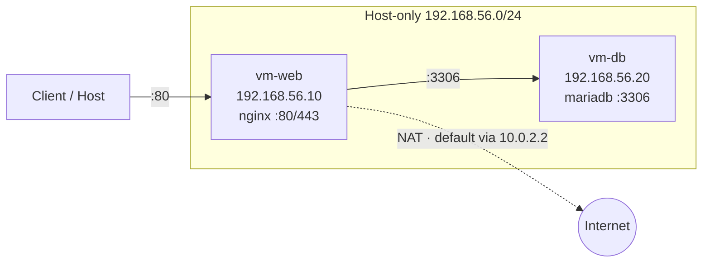
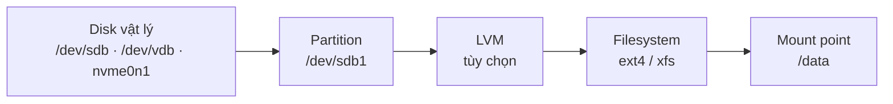
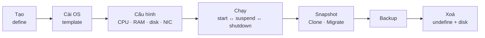
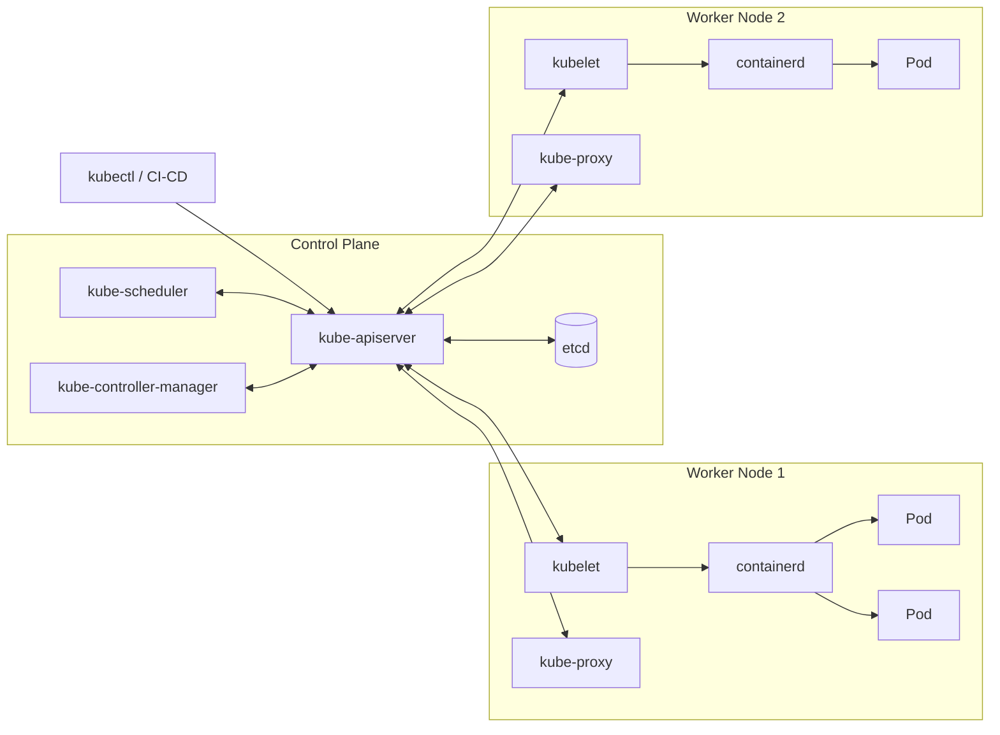

<div class="flex flex-col h-full justify-center">

<div class="text-sm tracking-widest uppercase opacity-70 mb-3">Báo cáo tiến độ học tập</div>

# Linux, Virtualization<br/>→ Container & Kubernetes

<div class="text-lg opacity-85 mt-2 mb-6">Tổng kết kiến thức Tuần 1 và Tuần 2</div>

<div>
<span class="pill"><logos-linux-tux /> Linux</span>
<span class="pill"><carbon-network-3 /> Network</span>
<span class="pill"><carbon-data-base /> Storage</span>
<span class="pill"><carbon-security /> Permission</span>
<span class="pill"><carbon-virtual-machine /> Hypervisor</span>
<span class="pill"><logos-docker-icon /> Container</span>
<span class="pill"><logos-kubernetes /> Kubernetes</span>
</div>

<div class="mt-10 text-sm opacity-80">Người báo cáo: <b>Lê Tấn Lực</b> · <b>Đỗ Hoàng Hiếu</b></div>

</div>

---

<div class="eyebrow"><carbon-dashboard /> Tổng quan</div>

# Tiến độ 2 tuần đầu

<div class="grid grid-cols-4 gap-3 mb-4">
  <div class="card stat"><div class="num">2</div><div class="lbl">tuần đã hoàn thành</div></div>
  <div class="card stat"><div class="num">8</div><div class="lbl">mảng kiến thức</div></div>
  <div class="card stat"><div class="num">6</div><div class="lbl">mảng hạ tầng nền tảng</div></div>
  <div class="card stat"><div class="num" style="color:var(--w2)">2</div><div class="lbl">mảng Container & K8s</div></div>
</div>

<div class="grid grid-cols-2 gap-4">
<div class="card accent">

### <carbon-calendar /> Tuần 1 – Linux, Virtualization và hạ tầng nền tảng

<div class="small">

1. Linux doanh nghiệp: CPU, RAM, disk, process
2. Network: IP, routing, DNS, kết nối VM
3. Storage: partition, LVM, filesystem, mount
4. User, group và permission
5. Service (systemd) và firewall
6. Hypervisor và vòng đời VM

</div>
</div>
<div class="card accent2">

### <carbon-calendar /> Tuần 2 – Container và Kubernetes Foundation

<div class="small">

7. Container: image, registry, volume, network, resource limit
8. Kiến trúc Kubernetes và vai trò từng thành phần

</div>

<div class="card soft2 mt-3 small">
<b>Mạch kiến thức:</b> hiểu máy chủ Linux → ảo hóa thành nhiều VM → đóng gói ứng dụng thành container → điều phối container ở quy mô cluster bằng Kubernetes.
</div>
</div>
</div>

---
layout: section
class: sec-w1
---

<div class="text-sm tracking-widest uppercase opacity-70 mb-2">Tuần 1</div>

# Linux, Virtualization<br/>và hạ tầng nền tảng

<div class="mt-6">
<span class="pill"><logos-linux-tux /> Tài nguyên máy chủ</span>
<span class="pill"><carbon-network-3 /> Network</span>
<span class="pill"><carbon-data-base /> Storage & LVM</span>
<span class="pill"><carbon-security /> User & Permission</span>
<span class="pill"><carbon-settings-services /> systemd & Firewall</span>
<span class="pill"><carbon-virtual-machine /> Hypervisor & VM</span>
</div>

---

<div class="eyebrow"><carbon-flag /> Tuần 1 · Tổng quan</div>

# Mục tiêu Tuần 1 và tiêu chí đầu ra

| # | Chủ đề | Tiêu chí đầu ra (theo roadmap) |
|:-:|---|---|
| 1 | Linux doanh nghiệp: CPU, RAM, disk, process | Kiểm tra và phân bổ được tài nguyên; giải thích được cho người khác |
| 2 | Network: IP, routing, DNS, kết nối VM | Vẽ và giải thích được luồng kết nối mạng giữa các VM trong Lab |
| 3 | Storage: partition, LVM, filesystem, mount | Tự thêm được disk mới, tạo LVM và mount vào hệ thống |
| 4 | User, group và permission | Tạo và phân quyền được theo đúng yêu cầu của ứng dụng |
| 5 | Service (systemd) và firewall | Quản lý được vòng đời dịch vụ; mở/đóng port theo yêu cầu |
| 6 | Hypervisor và vòng đời VM | Thao tác đầy đủ vòng đời VM trên hypervisor đang dùng |

<div class="grid grid-cols-3 gap-3 mt-3">
<div class="card soft small"><b>Cách tiếp cận:</b> đo → xác định nút thắt (bottleneck) → phân bổ hoặc giới hạn.</div>
<div class="card soft small"><b>Môi trường Lab:</b> 2 VM <code>vm-web</code> (nginx) và <code>vm-db</code> (mariadb) trên KVM / VirtualBox.</div>
<div class="card soft small"><b>Mỗi chủ đề gồm:</b> lý thuyết, lệnh thực hành và một ví dụ dễ hiểu để trình bày.</div>
</div>

---

<div class="eyebrow"><logos-linux-tux /> Tuần 1 · 1/6 · Linux tài nguyên</div>

# CPU và Load Average

<div class="grid grid-cols-2 gap-4">
<div class="flex flex-col gap-2">
<div class="card accent small">

### <carbon-chip /> Cấu trúc CPU

- **Socket → Core → Thread:** Hyper-Threading cho mỗi core 2 thread. Linux coi mỗi thread là 1 **CPU logic** (`lscpu`, `nproc`)
- **CPU time:** <span class="chip">us</span> ứng dụng <span class="chip">sy</span> kernel <span class="chip">ni</span> process đã nice <span class="chip">id</span> rảnh <span class="chip">wa</span> chờ disk <span class="chip">st</span> hypervisor lấy cho VM khác

</div>
<div class="card accent small">

### <carbon-meter /> Load average (1 · 5 · 15 phút)

Số process trung bình **đang chạy hoặc chờ CPU** cộng với số process đang chờ I/O (trạng thái `D`). Đem so với số CPU logic:
- Load **4.0** trên máy 4 CPU = đầy tải 100%
- Load **8.0** trên máy 4 CPU = hàng đợi gấp đôi

</div>
</div>
<div>

```bash
lscpu | grep -E "^CPU\(s\)|Thread|Core|Socket"
uptime              # load average: 0.52, 0.40, 0.31
top                 # nhấn 1: từng CPU · P: sắp theo CPU
mpstat -P ALL 1 3   # thống kê từng core (sysstat)
vmstat 1 5          # r = hàng đợi CPU, wa = chờ I/O
```

| Hiện tượng | Ý nghĩa | Hướng xử lý |
|---|---|---|
| `us` cao | Ứng dụng tính toán nặng | Tối ưu code, thêm vCPU |
| `sy` cao | Nhiều system call | `pidstat -w`, xem số thread |
| `wa` cao | CPU rảnh, chờ disk | Điều tra disk, không phải thiếu CPU |
| `st` cao | Host bị overcommit | Báo đội hạ tầng, migrate VM |

</div>
</div>

---

<div class="eyebrow"><logos-linux-tux /> Tuần 1 · 1/6 · Linux tài nguyên</div>

# Bộ nhớ (RAM, swap) và Disk

<div class="grid grid-cols-2 gap-4">
<div class="flex flex-col gap-2">

```bash
free -h
#        total   used   free  buff/cache  available
# Mem:   3.8Gi  1.1Gi  210Mi       2.5Gi      2.4Gi
vmstat 1    # si/so > 0 liên tục = đang swap → thiếu RAM
```

<div class="card accent small">

### <carbon-data-1 /> RAM

- Linux dùng RAM rảnh làm **page cache**, nên *free* thấp là bình thường. Chỉ số cần nhìn là **available**
- **RSS** = RAM vật lý đang dùng · **VSZ** = không gian ảo (thường lớn, không đáng lo)
- **Swap** chậm hơn RAM hàng nghìn lần. Với DB server nên đặt `vm.swappiness` = 1–10
- Hết RAM và swap → **OOM Killer** giết process (`dmesg -T | grep -i oom`)

</div>
</div>
<div class="flex flex-col gap-2">
<div class="card accent small">

### <carbon-vmdk-disk /> Disk: hai câu hỏi khác nhau

**Còn bao nhiêu chỗ?** (capacity) và **disk có đang nghẽn không?** (I/O)

</div>

```bash
df -hT ; df -i          # hết inode cũng "đầy disk"
du -sh /var/* | sort -h # thư mục chiếm chỗ
iostat -xz 1 3          # %util ~100%, await cao = nghẽn
sudo iotop -o           # process nào đang đọc/ghi
lsof +L1                # file đã xoá nhưng còn bị giữ
```

| Chỉ số iostat | Ý nghĩa |
|---|---|
| `r/s`, `w/s` | Số IOPS đọc/ghi mỗi giây |
| `r_await`, `w_await` | Độ trễ (ms). SSD nên dưới vài ms |
| `%util` | ~100% liên tục = disk bão hòa |

</div>
</div>

---

<div class="eyebrow"><logos-linux-tux /> Tuần 1 · 1/6 · Linux tài nguyên</div>

# Process, giới hạn tài nguyên và phương pháp USE

<div class="grid grid-cols-2 gap-4">
<div class="card accent small">

### <carbon-flow /> Process

- Trạng thái: `R` chạy · `S` ngủ · `D` chờ I/O · `T` dừng · `Z` zombie
- Signal: **SIGTERM 15** dừng lịch sự · **SIGKILL 9** buộc dừng · **SIGHUP 1** reload cấu hình
- `nice` từ −20 (ưu tiên cao) đến 19. Giảm nice cần quyền root
- **cgroups** giới hạn CPU/RAM/IO cho nhóm process. Đây là nền tảng của systemd và container

</div>
<div>

```bash
ps -eo pid,ppid,user,stat,%cpu,%mem,cmd --sort=-%cpu | head
kill -15 1234 ; pkill -HUP nginx
nice -n 10 tar czf backup.tgz /data
ionice -c3 -p 1234              # I/O ưu tiên "idle"
sudo systemctl set-property nginx.service \
     CPUQuota=50% MemoryMax=512M
```

</div>
</div>

<div class="grid grid-cols-2 gap-4 mt-2">
<div class="card soft small">

<b>USE Method:</b> với mỗi tài nguyên, kiểm tra **U**tilization (mức dùng), **S**aturation (hàng đợi) và **E**rrors (lỗi). Quy trình 60 giây: `uptime` → `dmesg -T | tail` → `vmstat` → `mpstat` → `pidstat` → `iostat` → `free` → `sar -n DEV`

</div>
<div class="tip">
<div class="tip-title">💡 Ví dụ trình bày: server như một nhà hàng</div>
<b>CPU</b> là đầu bếp, <b>load</b> là số món đang chờ nấu: 4 đầu bếp mà 8 món chờ là quá tải gấp đôi. <b>RAM</b> là mặt bàn bếp, <b>cache</b> là nguyên liệu bày sẵn, dọn đi được ngay. <b>%wa</b> cao là đầu bếp đứng chờ người lấy đồ trong kho (disk).
</div>
</div>

<div class="outcome">🎯 <span><b>Đầu ra:</b> Kiểm tra và phân bổ được tài nguyên; giải thích được cho người khác</span></div>

---

<div class="eyebrow"><carbon-network-3 /> Tuần 1 · 2/6 · Network</div>

# Địa chỉ IP, CIDR và routing

<div class="grid grid-cols-2 gap-4">
<div class="flex flex-col gap-2">

| CIDR | Mask | Host dùng được | Ví dụ |
|---|---|---|---|
| /8 | 255.0.0.0 | 16.777.214 | 10.0.0.0/8 (private) |
| /16 | 255.255.0.0 | 65.534 | 172.16.0.0/12 |
| /24 | 255.255.255.0 | 254 | 192.168.56.0/24 |
| /28 | 255.255.255.240 | 14 | Subnet nhỏ cho DMZ |
| /32 | 255.255.255.255 | 1 | Route tới 1 IP |

<div class="card accent small">

- **Số host = 2^(32 − prefix) − 2** (trừ địa chỉ network và broadcast)
- `192.168.56.10/24` → network `.0`, broadcast `.255`, host từ `.1` đến `.254`
- **Private (RFC 1918)** không ra Internet được, phải đi qua NAT
- Cùng subnet thì gửi thẳng qua switch (ARP lấy MAC). Khác subnet thì phải qua gateway

</div>
</div>
<div class="flex flex-col gap-2">
<div class="card accent small">

### <carbon-direction-fork /> Gói tin đi đâu?

- Kernel chọn route **khớp dài nhất** (longest prefix match). Không khớp route nào thì đi theo **default route** `0.0.0.0/0`
- Có nhiều route cùng độ dài thì route có **metric** thấp hơn được ưu tiên
- **Lỗi hay gặp:** 2 interface cùng có default gateway → traffic ra sai cổng. Chỉ nên có 1 default route

</div>

```bash
ip -br addr                 # interface + IP gọn
ip route
# default via 10.0.2.2 dev enp0s3 metric 100
# 192.168.56.0/24 dev enp0s8 src 192.168.56.10
ip route get 8.8.8.8        # kernel chọn route nào
ip route add 10.10.0.0/16 via 192.168.56.1
sysctl -w net.ipv4.ip_forward=1   # Linux làm router
```

</div>
</div>

---

<div class="eyebrow"><carbon-network-3 /> Tuần 1 · 2/6 · Network</div>

# Cấu hình IP vĩnh viễn và DNS

<div class="grid grid-cols-2 gap-4">
<div class="flex flex-col gap-2">

```bash
# RHEL/Rocky – NetworkManager
nmcli con mod enp0s8 ipv4.method manual \
  ipv4.addresses 192.168.56.10/24 ipv4.gateway 192.168.56.1 \
  ipv4.dns "8.8.8.8 1.1.1.1"
nmcli con up enp0s8
```

```yaml
# Ubuntu – Netplan: /etc/netplan/01-lab.yaml
network:
  version: 2
  ethernets:
    enp0s8:
      addresses: [192.168.56.10/24]
      nameservers: { addresses: [8.8.8.8] }
# netplan try  → tự rollback sau 120s nếu mất kết nối
```

<div class="card warn xs">Lệnh <code>ip addr add</code> chỉ có tác dụng tạm thời và mất khi reboot. Muốn cấu hình vĩnh viễn phải dùng nmcli hoặc Netplan.</div>

</div>
<div class="flex flex-col gap-2">
<div class="card accent small">

### <carbon-search-locate /> DNS phân giải tên

- Thứ tự phân giải ghi trong `/etc/nsswitch.conf` (`hosts: files dns`): đọc `/etc/hosts` trước, sau đó mới hỏi DNS server trong `/etc/resolv.conf`
- **Luồng truy vấn:** client → resolver (8.8.8.8) → root → TLD (`.com`) → authoritative. Kết quả được cache theo **TTL**
- **Bản ghi:** A · AAAA · CNAME · MX · NS · PTR · TXT
- Ubuntu dùng **systemd-resolved**: resolv.conf trỏ tới `127.0.0.53`, xem cấu hình thật bằng `resolvectl status`

</div>

```bash
dig google.com +short ; dig -x 8.8.8.8
dig @1.1.1.1 example.com MX
getent hosts vm-db       # đi qua nsswitch (cả /etc/hosts)
# /etc/hosts trong lab
192.168.56.10  vm-web
192.168.56.20  vm-db
```

</div>
</div>

---

<div class="eyebrow"><carbon-network-3 /> Tuần 1 · 2/6 · Network</div>

# Mạng ảo cho VM và sơ đồ Lab

<div class="grid grid-cols-2 gap-4">
<div class="flex flex-col gap-2">

| Chế độ | Cách hoạt động | Internet | Host↔VM | VM↔VM |
|---|---|:-:|:-:|:-:|
| **NAT** | Hypervisor làm router NAT | ✅ | Port fwd | Tùy |
| **Bridged** | Như máy thật trong LAN | ✅ | ✅ | ✅ |
| **Host-only** | Mạng riêng host + VM | ❌ | ✅ | ✅ |
| **Internal** | Chỉ VM với VM | ❌ | ❌ | ✅ |

<div class="card soft xs">

**KVM/libvirt:** `virbr0` (NAT 192.168.122.0/24, DHCP dnsmasq), bridge `br0` cho bridged · **VMware:** VMnet8 NAT, VMnet1 Host-only, VMnet0 Bridged · **Proxmox:** Linux bridge `vmbr0`

</div>
</div>
<div class="flex flex-col">



<div class="card accent xs mt-1">

**Luồng:** Client → `vm-web:80` qua mạng host-only → `vm-db:3306`. Riêng `vm-web` ra Internet qua NAT (NIC `enp0s3`, 10.0.2.15).

</div>

<div class="tip mt-2">
<div class="tip-title">💡 Ví dụ trình bày: mạng như hệ thống bưu điện</div>
<b>IP</b> là địa chỉ nhà, <b>subnet /24</b> là cùng một con phố nên gửi thư thì đưa tận tay (switch/ARP). <b>Gateway</b> là bưu cục đầu phố, <b>routing table</b> là bảng chỉ đường chọn tuyến cụ thể nhất. <b>DNS</b> là danh bạ, tra tên "vm-db" ra 192.168.56.20 trước khi gửi.
</div>
</div>
</div>

<div class="outcome">🎯 <span><b>Đầu ra:</b> Vẽ và giải thích được luồng kết nối mạng giữa các VM trong Lab</span></div>

---

<div class="eyebrow"><carbon-data-base /> Tuần 1 · 3/6 · Storage</div>

# Chuỗi lưu trữ, partition và LVM



<div class="grid grid-cols-2 gap-4 mt-2">
<div>

| | MBR (msdos) | GPT |
|---|---|---|
| Disk tối đa | 2 TiB | ~9.4 ZB (gần như không giới hạn) |
| Số partition | 4 primary (hoặc 3 + extended) | 128 mặc định |
| Boot | BIOS legacy | UEFI |
| Độ bền | 1 bảng duy nhất | Có bản sao header ở cuối disk + CRC |

```bash
lsblk -f ; blkid ; findmnt       # xem thiết bị, UUID, mount
parted /dev/sdb --script mklabel gpt \
  mkpart primary 0% 100% set 1 lvm on
```

</div>
<div class="flex flex-col gap-2">

| Thành phần | Là gì | Lệnh |
|---|---|---|
| **PV** Physical Volume | Disk/partition được khởi tạo cho LVM | `pvcreate`, `pvs` |
| **VG** Volume Group | "Bể" dung lượng gộp từ nhiều PV, chia thành PE (4 MiB) | `vgcreate`, `vgextend` |
| **LV** Logical Volume | "Partition ảo" cắt từ VG, nơi tạo filesystem | `lvcreate`, `lvextend` |

<div class="card soft small">
<b>Vì sao dùng LVM:</b> có một lớp trừu tượng giữa disk và filesystem, nhờ đó gộp được nhiều disk, <b>mở rộng khi đang chạy</b> và tạo snapshot.
</div>
</div>
</div>

---

<div class="eyebrow"><carbon-data-base /> Tuần 1 · 3/6 · Storage</div>

# Thực hành LVM, filesystem và /etc/fstab

<div class="grid grid-cols-2 gap-4">
<div class="flex flex-col gap-2">

```bash
pvcreate /dev/sdb1
vgcreate vg_data /dev/sdb1
lvcreate -n lv_app -L 5G vg_data      # hoặc -l 100%FREE
mkfs.xfs /dev/vg_data/lv_app
# Mở rộng khi thêm disk /dev/sdc – không downtime
pvcreate /dev/sdc && vgextend vg_data /dev/sdc
lvextend -r -L +3G /dev/vg_data/lv_app   # -r: resize FS
# Snapshot LV trước khi nâng cấp
lvcreate -s -n snap_app -L 1G /dev/vg_data/lv_app
```

```bash
echo 'UUID=<uuid> /data/app xfs defaults,nofail 0 0' >> /etc/fstab
mount -a && findmnt --verify     # LUÔN kiểm tra trước reboot
```

<div class="tip">
<div class="tip-title">💡 Ví dụ trình bày: storage như kho hàng</div>
<b>Disk</b> là mảnh đất, <b>partition</b> là chia lô, <b>LVM</b> gộp nhiều lô thành một khu (VG) rồi chia lại linh hoạt thành các kho (LV). <b>Filesystem</b> là cách xếp kệ, <b>mount</b> là gắn biển địa chỉ "/data/app". Sắp đầy thì thêm disk, chạy vgextend + lvextend -r, không downtime.
</div>

</div>
<div class="flex flex-col gap-2">

| Tiêu chí | ext4 | xfs |
|---|---|---|
| Mặc định trên | Ubuntu, Debian | RHEL, Rocky, Alma |
| Mở rộng online | `resize2fs` | `xfs_growfs` |
| Thu nhỏ | Được (phải umount) | **Không hỗ trợ** |
| Điểm mạnh | Ổn định, linh hoạt | File lớn, song song cao |

<div class="card accent small">

### <carbon-document /> 6 cột của fstab

thiết bị · mount point · loại FS · options (`defaults`, `noatime`, `nofail`, `ro`) · dump · fsck pass (0 tắt, 1 cho `/`, 2 cho FS khác)
- Dùng **UUID** vì tên `/dev/sdX` có thể đổi khi thêm disk
- Một dòng sai có thể khiến máy vào **emergency mode**. `nofail` tránh lỗi này với disk phụ

</div>
</div>
</div>

<div class="outcome">🎯 <span><b>Đầu ra:</b> Tự thêm được disk mới, tạo LVM và mount vào hệ thống</span></div>

---

<div class="eyebrow"><carbon-security /> Tuần 1 · 4/6 · Permission</div>

# User, group và quyền cơ bản rwx

<div class="grid grid-cols-2 gap-4">
<div class="flex flex-col gap-2">

| File | Nội dung |
|---|---|
| `/etc/passwd` | user:x:UID:GID:mô tả:home:shell |
| `/etc/shadow` | Mật khẩu đã hash, chính sách hết hạn (chỉ root đọc) |
| `/etc/group` | group:x:GID:danh sách thành viên |
| `/etc/sudoers.d/` | Quy tắc sudo, sửa bằng `visudo` |

```bash
useradd -m -s /bin/bash -c "Dev Luc" luc ; passwd luc
groupadd devteam
usermod -aG devteam luc     # thiếu -a sẽ XOÁ các group cũ!
useradd -r -s /usr/sbin/nologin -d /opt/myapp myapp
chage -M 90 luc ; usermod -L luc ; userdel -r olduser
```

<div class="card soft xs">UID 0 là root. UID dưới 1000 là system user dành cho dịch vụ (nginx, mysql), không có shell đăng nhập.</div>

</div>
<div class="flex flex-col gap-2">

| Quyền | Số | Với file | Với thư mục |
|:-:|:-:|---|---|
| **r** | 4 | Đọc nội dung | Liệt kê tên file (`ls`) |
| **w** | 2 | Sửa nội dung | Tạo / xoá / đổi tên file bên trong |
| **x** | 1 | Thực thi | Đi vào (`cd`), truy cập file bên trong |

<div class="card accent small">

### <carbon-rule /> 3 quy tắc hay bị nhầm

1. Kernel kiểm tra theo thứ tự **owner → group → others**, áp dụng nhóm đầu tiên khớp, **không cộng dồn**
2. Đọc `/a/b/file` cần quyền `x` trên `/a` và `/a/b`. Kiểm tra bằng `namei -l`
3. **Xoá file** phụ thuộc quyền `w` của **thư mục**, không phụ thuộc quyền của file

</div>

```bash
chmod 640 config.yml ; chmod -R g+rX /srv/share
chown -R myapp:devteam /opt/myapp
umask      # 0022 → file mới 644, thư mục mới 755
```

</div>
</div>

---

<div class="eyebrow"><carbon-security /> Tuần 1 · 4/6 · Permission</div>

# Quyền đặc biệt, ACL và sudo

<div class="grid grid-cols-2 gap-4">
<div class="flex flex-col gap-2">

| Bit | Số | Ý nghĩa | Ví dụ |
|---|:-:|---|---|
| **SUID** | 4000 | File chạy với quyền của owner | `/usr/bin/passwd` |
| **SGID** | 2000 | File mới trong thư mục kế thừa group | Thư mục dự án chung |
| **Sticky** | 1000 | Chỉ owner mới xoá được file của mình | `/tmp` (drwxrwxrwt) |

```bash
chmod 2775 /srv/project                  # SGID thư mục nhóm
find / -perm -4000 -type f 2>/dev/null   # audit file SUID
setfacl -m u:deploy:rx /opt/myapp        # ACL cho 1 user
setfacl -d -m g:devteam:rwX /srv/project # default ACL
getfacl /opt/myapp
```

</div>
<div class="flex flex-col gap-2">

```bash
# visudo -f /etc/sudoers.d/devteam
%devteam ALL=(root) /usr/bin/systemctl restart myapp, \
                    /usr/bin/journalctl -u myapp
deploy   ALL=(myapp) NOPASSWD: /opt/myapp/bin/deploy.sh
sudo -l -U luc        # xem user được phép chạy gì
```

<div class="card accent small">

### <carbon-locked /> Nguyên tắc quyền tối thiểu

- Không đăng nhập trực tiếp bằng root. Tắt `PermitRootLogin` trong sshd_config
- Mỗi ứng dụng một system user riêng, không có shell, chỉ sở hữu thư mục của nó
- **SELinux** (RHEL): rwx đúng mà vẫn bị từ chối thì kiểm tra `ls -Z`, `ausearch -m avc`, `restorecon -Rv`

</div>
</div>
</div>

<div class="tip mt-2">
<div class="tip-title">💡 Ví dụ trình bày: phân quyền như thẻ ra vào toà nhà</div>
<b>User</b> là nhân viên, <b>group</b> là phòng ban, <b>rwx</b> là được xem, sửa, đi vào. Chỉ user <code>myapp</code> đọc được file mật khẩu DB (600), dev chỉ đọc log, deploy ghi code qua ACL. <b>sudo giới hạn</b> là thẻ chỉ mở đúng phòng cần thiết, không phải chìa khoá vạn năng.
</div>

<div class="outcome">🎯 <span><b>Đầu ra:</b> Tạo và phân quyền được theo đúng yêu cầu của ứng dụng</span></div>

---

<div class="eyebrow"><carbon-settings-services /> Tuần 1 · 5/6 · systemd & firewall</div>

# systemd và vòng đời dịch vụ

<div class="grid grid-cols-2 gap-4">
<div class="flex flex-col gap-2">
<div class="card accent small">

**systemd** là PID 1 trên hầu hết bản Linux hiện đại. Nó khởi động hệ thống, quản lý dịch vụ, log (journald), mount và timer. Đơn vị quản lý là **unit**: `.service` `.socket` `.timer` `.mount` `.target`

</div>

| Lệnh `systemctl …` | Tác dụng |
|---|---|
| `start` / `stop` / `restart` | Chạy / dừng / khởi động lại ngay |
| `reload` | Đọc lại cấu hình, không ngắt kết nối |
| `enable --now` | Tự chạy khi boot và chạy ngay |
| `disable` / `mask` | Không tự chạy / cấm hoàn toàn |
| `status` · `list-units --failed` | Trạng thái, PID, log gần nhất · dịch vụ lỗi |
| `daemon-reload` | **Bắt buộc** sau khi sửa unit file |

```bash
systemctl edit nginx       # tạo override thay vì sửa file gốc
systemd-analyze blame      # dịch vụ nào làm boot chậm
journalctl -u myapp -f ; journalctl -b -1   # log boot trước
```

</div>
<div>

```ini
# /etc/systemd/system/myapp.service
[Unit]
Description=My Application
After=network-online.target
Wants=network-online.target

[Service]
Type=simple
User=myapp
WorkingDirectory=/opt/myapp
EnvironmentFile=/etc/myapp/app.env
ExecStart=/opt/myapp/bin/server --port 8080
Restart=on-failure
RestartSec=5
MemoryMax=512M
CPUQuota=50%
NoNewPrivileges=true

[Install]
WantedBy=multi-user.target
```

</div>
</div>

---

<div class="eyebrow"><carbon-firewall /> Tuần 1 · 5/6 · systemd & firewall</div>

# Firewall và kiểm tra port từ đầu đến cuối

<div class="grid grid-cols-2 gap-4">
<div>

```bash
# firewalld (RHEL/Rocky) – quản lý theo zone
firewall-cmd --get-active-zones ; firewall-cmd --list-all
firewall-cmd --permanent --add-service=http
firewall-cmd --permanent --add-port=8080/tcp
firewall-cmd --permanent --add-rich-rule='rule family=ipv4
  source address=192.168.56.10/32 port port=3306
  protocol=tcp accept'      # chỉ vm-web được vào DB
firewall-cmd --reload       # permanent có hiệu lực sau reload
```

</div>
<div>

```bash
# ufw (Ubuntu)
ufw default deny incoming ; ufw default allow outgoing
ufw allow OpenSSH           # LUÔN mở SSH trước khi enable!
ufw allow 80/tcp
ufw allow from 192.168.56.10 to any port 3306
ufw enable ; ufw status numbered ; ufw delete 3
# mức thấp: nft list ruleset ; iptables -L -n -v
```

</div>
</div>

<div class="grid grid-cols-2 gap-4 mt-2">
<div class="card accent small">

### <carbon-checkmark-outline /> Kiểm tra port end-to-end

`ss -tulpn` (dịch vụ có LISTEN không, trên 0.0.0.0 hay 127.0.0.1?) → `nc -zv 192.168.56.20 3306` từ máy khác → `curl -I http://192.168.56.10`
- Dịch vụ chỉ listen **127.0.0.1** thì máy khác không vào được dù firewall đã mở. Phải sửa `bind-address`
- RHEL dùng port lạ thì cần mở cả SELinux: `semanage port -a -t http_port_t -p tcp 8081`

</div>
<div class="tip">
<div class="tip-title">💡 Ví dụ trình bày: systemd là quản lý ca, firewall là bảo vệ cổng</div>
systemd cho dịch vụ vào ca khi boot (<b>enable</b>), tự gọi lại khi dịch vụ "ngã" (<b>Restart=on-failure</b>) và ghi sổ nhật ký (<b>journalctl</b>). Firewall mặc định đóng mọi cửa, chỉ mở 80/443 cho khách. Cửa 3306 của DB chỉ mở cho đúng vm-web, nhờ vậy bề mặt tấn công nhỏ nhất.
</div>
</div>

<div class="outcome">🎯 <span><b>Đầu ra:</b> Quản lý được vòng đời dịch vụ; mở/đóng port theo yêu cầu</span></div>

---

<div class="eyebrow"><carbon-virtual-machine /> Tuần 1 · 6/6 · Hypervisor</div>

# Hypervisor là gì?

<div class="card soft small mb-2">

**Hypervisor (VMM)** chia tài nguyên vật lý thành nhiều máy ảo độc lập. CPU hiện đại hỗ trợ ảo hóa phần cứng (**Intel VT-x / AMD-V**, kiểm tra bằng `grep -cE "vmx|svm" /proc/cpuinfo`) để VM chạy gần tốc độ thật.

</div>

<div class="grid grid-cols-2 gap-4">

| | Type 1 (bare-metal) | Type 2 (hosted) |
|---|---|---|
| Chạy trên | Trực tiếp phần cứng | Một OS có sẵn |
| Ví dụ | ESXi, Proxmox VE (KVM), Hyper-V, Xen, Nutanix AHV | VirtualBox, VMware Workstation/Fusion |
| Dùng cho | Production, datacenter | Lab cá nhân, dev |

<div class="card accent small">

### <carbon-layers /> KVM · QEMU · libvirt

- **KVM**: module kernel biến Linux thành hypervisor
- **QEMU**: giả lập thiết bị cho VM
- **libvirt**: lớp quản lý (`virsh`, `virt-install`, `virt-manager`)
- Proxmox và OpenStack đều dựa trên KVM

</div>
</div>

<div class="grid grid-cols-3 gap-3 mt-3">
<div class="card accent xs">

### <carbon-flash /> Thiết bị paravirtual

`virtio-blk/scsi` cho disk, `virtio-net` cho NIC, hiệu năng tốt hơn thiết bị giả lập. VMware dùng VMware Tools, `vmxnet3`, `pvscsi`.

</div>
<div class="card accent xs">

### <carbon-chart-multitype /> Overcommit

Cấp tổng vCPU/RAM cho các VM vượt tài nguyên thật. **vCPU 3–4:1** thường chấp nhận được. **RAM overcommit rủi ro hơn** (balloon, host phải swap).

</div>
<div class="card accent xs">

### <carbon-vmdk-disk /> Định dạng disk

**qcow2** (KVM, thin + snapshot) · **raw** (nhanh nhất) · **vmdk** (VMware) · **vhdx** (Hyper-V). Thin provisioning tiết kiệm chỗ nhưng có thể làm đầy datastore.

</div>
</div>

---

<div class="eyebrow"><carbon-virtual-machine /> Tuần 1 · 6/6 · Hypervisor</div>

# Vòng đời VM và thao tác trên các nền tảng



<div class="grid grid-cols-2 gap-4 mt-2">
<div>

```bash
virt-install --name vm-web --memory 2048 --vcpus 2 \
  --disk size=20,format=qcow2,bus=virtio \
  --cdrom /iso/Rocky-9.iso --os-variant rocky9 \
  --network network=default,model=virtio
virsh list --all ; virsh dominfo vm-web
virsh start | shutdown | suspend | resume vm-web
virsh setvcpus vm-web 4 --config ; virsh setmem vm-web 4G --config
virsh attach-disk vm-web data.qcow2 vdb --persistent
virt-clone --original vm-web --name vm-web2 --auto-clone
virsh undefine vm-web2 --remove-all-storage
```

</div>
<div>

| Thao tác | Proxmox (`qm`) | VMware ESXi | VirtualBox |
|---|---|---|---|
| Tạo | `qm create 101 --memory 2048 --cores 2` | Wizard / PowerCLI `New-VM` | `createvm` + `modifyvm` |
| Start / Stop | `qm start` / `shutdown 101` | Power On / Shut Down | `startvm --type headless` |
| Snapshot | `qm snapshot 101 pre-upd` | Take Snapshot | `snapshot vm take` |
| Backup | `vzdump 101 --mode snapshot` | Veeam, vSphere Data Protection | `export vm -o vm.ova` |

</div>
</div>

---

<div class="eyebrow"><carbon-virtual-machine /> Tuần 1 · 6/6 · Hypervisor</div>

# Snapshot và Backup không phải là một

<div class="grid grid-cols-5 gap-4">
<div class="col-span-3 flex flex-col gap-2">

| | Snapshot | Backup |
|---|---|---|
| Bản chất | Điểm khôi phục, lưu phần chênh lệch (delta) so với disk gốc | Bản sao độc lập, đầy đủ của dữ liệu |
| Vị trí | Cùng storage với VM | Storage khác, tốt nhất ở site khác |
| Mất storage gốc | **Mất luôn** snapshot | **Vẫn khôi phục được** |
| Dùng khi | Trước khi update, rollback nhanh | Phòng thảm họa, lưu trữ lâu dài |
| Giữ lâu | Không nên (làm chậm I/O, phình disk) | Theo chính sách retention |

```bash
virsh snapshot-create-as vm-web pre-update "Truoc khi update kernel"
virsh snapshot-revert vm-web pre-update
virsh dumpxml vm-web > /backup/vm-web.xml      # backup cold
qemu-img convert -O qcow2 -c vm-web.qcow2 /backup/vm-web.qcow2
```

</div>
<div class="col-span-2 flex flex-col gap-2">
<div class="card accent small"><b>Quy tắc 3-2-1:</b> 3 bản dữ liệu, trên 2 loại phương tiện, 1 bản ở ngoài site.</div>
<div class="card accent small"><b>Application-consistent:</b> với DB, dùng qemu-guest-agent (<code>virsh domfsfreeze</code>) hoặc dump DB trước khi snapshot để tránh dữ liệu ghi dở.</div>
<div class="card accent small"><b>RPO / RTO:</b> mất tối đa bao nhiêu dữ liệu / khôi phục trong bao lâu. Backup chưa từng restore thử thì coi như chưa có backup.</div>
<div class="tip">
<div class="tip-title">💡 Ví dụ: hypervisor như toà chung cư</div>
Hypervisor là ban quản lý chia căn hộ (VM). <b>Snapshot</b> là chụp ảnh căn hộ trước khi sửa, nhưng ảnh vẫn nằm trong toà nhà. <b>Backup</b> là bản sao cất ở toà nhà khác, cháy toà nhà vẫn khôi phục được.
</div>
</div>
</div>

<div class="outcome">🎯 <span><b>Đầu ra:</b> Thao tác đầy đủ vòng đời VM trên hypervisor đang dùng</span></div>

---

<div class="eyebrow"><carbon-debug /> Tuần 1 · Áp dụng</div>

# Troubleshooting nhanh

| Triệu chứng | Kiểm tra | Hướng xử lý |
|---|---|---|
| Server chậm | `uptime`, `top`, `vmstat`, `iostat` | Xác định CPU / RAM / IO, xử lý process nguyên nhân |
| Boot vào emergency mode | `journalctl -xb`, `/etc/fstab` | Sửa dòng fstab sai, thêm `nofail` |
| Disk đầy | `df -h`, `df -i`, `du`, `lsof +L1` | Dọn log (logrotate), restart process giữ file, mở rộng LV |
| Service không chạy | `systemctl status`, `journalctl -u` | Sửa config hoặc quyền, `daemon-reload` |
| Không truy cập được port | `ss -tulpn`, `firewall-cmd --list-all`, `nc -zv` | Sửa bind address, mở firewall, SELinux port |
| Permission denied | `id`, `namei -l`, `getfacl`, `ls -Z` | Sửa owner / mode / ACL, `restorecon` |
| VM không có mạng | `ip a`, `ip r`, `virsh domiflist`, `virsh net-list` | Kiểm tra NIC model, bridge, DHCP, default route |

<div class="card soft small mt-3">
<b>Tài liệu tham khảo:</b> RHEL Documentation · Ubuntu Server Guide · Brendan Gregg – USE Method · <i>The Linux Command Line</i>, <i>How Linux Works</i> · libvirt.org, Proxmox VE Admin Guide. Chứng chỉ phù hợp: <b>RHCSA (EX200)</b>, <b>LFCS</b>.
</div>

---
layout: section
class: sec-w2
---

<div class="text-sm tracking-widest uppercase opacity-70 mb-2">Tuần 2</div>

# Container và<br/>Kubernetes Foundation

<div class="mt-6">
<span class="pill"><logos-docker-icon /> Image & Registry</span>
<span class="pill">Volume</span>
<span class="pill">Network</span>
<span class="pill">Resource limit</span>
<span class="pill"><logos-kubernetes /> Kiến trúc Kubernetes</span>
</div>

---

<div class="eyebrow t2"><logos-docker-icon /> Tuần 2 · Chủ đề 7</div>

# Container hoạt động như thế nào?

<div class="grid grid-cols-2 gap-4">
<div class="flex flex-col gap-3">
<div class="card accent2 small">

### <carbon-container-software /> Container là tiến trình được cô lập

Container không phải máy ảo. Đó là tiến trình chạy trên **kernel của host**, được kernel Linux cô lập bằng 3 cơ chế:

- **Namespaces**: cô lập những gì tiến trình *nhìn thấy*: `pid`, `net`, `mnt`, `uts` (hostname), `ipc`, `user`
- **cgroups**: giới hạn tài nguyên tiến trình *được dùng*: CPU, RAM, I/O
- **Union filesystem** (overlay2): ghép các layer chỉ đọc của image với một layer ghi riêng cho container

</div>
</div>
<div>

| Tiêu chí | Virtual Machine | Container |
|---|---|---|
| Ảo hóa | Phần cứng (hypervisor) | Hệ điều hành (kernel) |
| Hệ điều hành | Mỗi VM một Guest OS | Dùng chung kernel host |
| Kích thước | Vài GB | Vài chục – vài trăm MB |
| Khởi động | Phút | Giây |
| Mức cô lập | Mạnh | Yếu hơn |
| Phù hợp | Nhiều OS, cô lập cao | Microservice, CI/CD |

<div class="card soft2 small mt-2">
<b>Tóm lại:</b> VM ảo hóa cả một máy tính. Container chỉ cô lập ứng dụng, nên nhẹ và nhanh hơn nhưng phải dùng chung kernel.
</div>

</div>
</div>

<div class="outcome">🎯 <span><b>Đầu ra:</b> Giải thích được cơ chế container và khác biệt so với VM trong 5 phút</span></div>

---

<div class="eyebrow t2"><logos-docker-icon /> Tuần 2 · Chủ đề 7</div>

# Image và Registry

<div class="grid grid-cols-2 gap-4">
<div class="flex flex-col gap-3">
<div class="card accent2 small">

### <carbon-layers /> Image

- Template **chỉ đọc**, gồm nhiều **layer**. Mỗi lệnh trong Dockerfile tạo một layer
- Layer được **cache và dùng chung** giữa các image → build và pull nhanh
- Container = image + một layer ghi. Xóa container thì layer ghi mất

</div>
<div class="card accent2 small">

### <carbon-cloud-upload /> Registry

- Nơi lưu và phân phối image: Docker Hub, Harbor, GitLab Registry, ECR…
- Tên đầy đủ: `registry.company.vn/team/webapp:1.4.2`
- **Không dùng tag `latest`** cho production vì không biết chính xác phiên bản đang chạy

</div>
</div>
<div>

```dockerfile
# Multi-stage build: image cuối nhỏ gọn
FROM node:20-alpine AS build
WORKDIR /app
COPY package*.json ./
RUN npm ci          # layer được cache
COPY . .
RUN npm run build

FROM node:20-alpine
WORKDIR /app
COPY --from=build /app/dist ./dist
COPY --from=build /app/node_modules ./node_modules
USER node           # không chạy bằng root
EXPOSE 3000
CMD ["node", "dist/server.js"]
```

```bash
docker build -t registry.company.vn/team/webapp:1.4.2 .
docker push registry.company.vn/team/webapp:1.4.2
```

</div>
</div>

---

<div class="eyebrow t2"><logos-docker-icon /> Tuần 2 · Chủ đề 7</div>

# Volume, network và resource limit

<div class="grid grid-cols-3 gap-3">
<div class="card accent2 small">

### <carbon-data-volume /> Volume

Dữ liệu trong container mất khi container bị xóa, nên dữ liệu cần giữ phải để ngoài:

- **Named volume**: Docker quản lý, dùng cho database
- **Bind mount**: gắn thư mục host, tiện khi dev
- **tmpfs**: nằm trên RAM, dữ liệu tạm

</div>
<div class="card accent2 small">

### <carbon-network-4 /> Network

- **bridge** (mặc định): mạng riêng trên host, ra ngoài qua NAT
- **user-defined bridge**: container gọi nhau **bằng tên** nhờ DNS nội bộ
- **host**: dùng chung mạng của host
- **none**: không có mạng
- `-p 8080:80`: publish port host 8080 → container 80

</div>
<div class="card accent2 small">

### <carbon-meter /> Resource limit

- `--memory 512m`: vượt giới hạn thì container bị **OOM kill**
- `--cpus 1.5`: tối đa 1,5 core
- `--pids-limit`: giới hạn số tiến trình
- Không đặt limit thì một container có thể chiếm hết tài nguyên của host

</div>
</div>

```bash
docker network create appnet
docker volume create pgdata
docker run -d --name db  --network appnet -v pgdata:/var/lib/postgresql/data \
  -e POSTGRES_PASSWORD_FILE=/run/secrets/db_pass --memory 1g --cpus 1 postgres:16
docker run -d --name web --network appnet -p 8080:3000 \
  -e DB_HOST=db --memory 512m --cpus 0.5 registry.company.vn/team/webapp:1.4.2
docker stats                     # theo dõi CPU/RAM thực tế của từng container
```

---

<div class="eyebrow t2"><logos-kubernetes /> Tuần 2 · Chủ đề 8</div>

# Kiến trúc Kubernetes



<div class="grid grid-cols-2 gap-3 mt-1">
<div class="card soft2 small">
<b>Control Plane</b> là "bộ não": nhận yêu cầu, lưu trạng thái mong muốn, quyết định Pod chạy ở đâu và liên tục sửa lệch.
</div>
<div class="card soft2 small">
<b>Worker Node</b> là nơi chạy workload: nhận lệnh từ apiserver, chạy container và cấu hình mạng cho Service.
</div>
</div>

---

<div class="eyebrow t2"><logos-kubernetes /> Tuần 2 · Chủ đề 8</div>

# Vai trò từng thành phần

<div class="grid grid-cols-2 gap-4">
<div>

| Control Plane | Vai trò |
|---|---|
| **kube-apiserver** | Cổng duy nhất vào cluster. Xác thực, phân quyền, ghi/đọc etcd. Mọi thành phần khác giao tiếp qua đây |
| **etcd** | CSDL key-value lưu toàn bộ trạng thái cluster. Mất etcd là mất cluster, nên phải backup |
| **kube-scheduler** | Chọn node cho Pod mới dựa trên tài nguyên còn trống, affinity, taint/toleration |
| **controller-manager** | Chạy các controller (Deployment, ReplicaSet, Node…), so sánh trạng thái thực với mong muốn rồi sửa |

</div>
<div>

| Worker Node | Vai trò |
|---|---|
| **kubelet** | Agent trên mỗi node. Nhận Pod được giao, gọi runtime chạy container, báo cáo trạng thái và health check |
| **container runtime** | Chạy container thật qua chuẩn CRI: containerd, CRI-O |
| **kube-proxy** | Cấu hình iptables/IPVS để traffic tới **Service** được chia đều về các Pod |
| **CNI plugin** | Cấp IP cho Pod, cho Pod ở các node khác nhau nói chuyện được: Calico, Flannel, Cilium |

</div>
</div>

<div class="card soft2 small mt-3">

<b>Đối tượng cơ bản:</b> **Pod** (đơn vị nhỏ nhất, 1+ container) · **Deployment** (quản lý số bản sao, rolling update) · **Service** (IP/DNS ổn định trước nhóm Pod) · **Namespace** (chia cluster theo team/môi trường) · **ConfigMap / Secret** (cấu hình và thông tin nhạy cảm)

</div>

---

<div class="eyebrow t2"><logos-kubernetes /> Tuần 2 · Chủ đề 8</div>

# Luồng xử lý khi triển khai một ứng dụng

<div class="grid grid-cols-5 gap-4">
<div class="col-span-3 flex flex-col gap-1.5 small">
  <div class="card flex items-center" style="padding:0.4rem 0.8rem"><span class="step t2">1</span><span><b>kubectl apply</b> gửi Deployment (replicas: 3) tới <b>kube-apiserver</b>; apiserver xác thực rồi lưu vào <b>etcd</b></span></div>
  <div class="card flex items-center" style="padding:0.4rem 0.8rem"><span class="step t2">2</span><span><b>Deployment controller</b> thấy Deployment mới → tạo ReplicaSet → ReplicaSet tạo <b>3 Pod</b> (chưa có node)</span></div>
  <div class="card flex items-center" style="padding:0.4rem 0.8rem"><span class="step t2">3</span><span><b>kube-scheduler</b> thấy Pod chưa có node → chọn node phù hợp và ghi lại qua apiserver</span></div>
  <div class="card flex items-center" style="padding:0.4rem 0.8rem"><span class="step t2">4</span><span><b>kubelet</b> trên node đó thấy Pod được giao → gọi <b>containerd</b> pull image và chạy container</span></div>
  <div class="card flex items-center" style="padding:0.4rem 0.8rem"><span class="step t2">5</span><span>kubelet báo trạng thái <b>Running</b> về apiserver; <b>kube-proxy</b> cập nhật routing nếu có Service trỏ tới Pod</span></div>
  <div class="card soft2 xs" style="padding:0.4rem 0.8rem"><b>Cơ chế cốt lõi:</b> khai báo trạng thái mong muốn, hệ thống tự điều chỉnh. Pod chết thì controller tạo Pod mới thay thế.</div>
</div>
<div class="col-span-2 flex flex-col gap-2">

```yaml
apiVersion: apps/v1
kind: Deployment
metadata: { name: webapp }
spec:
  replicas: 3
  selector:
    matchLabels: { app: webapp }
  template:
    metadata:
      labels: { app: webapp }
    spec:
      containers:
      - name: web
        image: team/webapp:1.4.2
        resources:
          limits: { cpu: 500m, memory: 512Mi }
```


</div>
</div>

<div class="outcome">🎯 <span><b>Đầu ra:</b> Vẽ lại được kiến trúc Kubernetes không nhìn tài liệu</span></div>

---

<div class="eyebrow"><carbon-task-complete /> Tổng kết</div>

# Kết quả đạt được sau 2 tuần

| # | Mảng kiến thức | Đầu ra theo lộ trình | Trạng thái |
|:-:|---|---|:-:|
| 1 | Linux: CPU, RAM, disk, process | Kiểm tra và phân bổ được tài nguyên; giải thích được cho người khác | ✅ |
| 2 | Network: IP, routing, DNS, kết nối VM | Vẽ và giải thích được luồng kết nối mạng giữa các VM trong Lab | ✅ |
| 3 | Storage: partition, LVM, filesystem, mount | Tự thêm được disk mới, tạo LVM và mount vào hệ thống | ✅ |
| 4 | User, group và permission | Tạo và phân quyền được theo đúng yêu cầu của ứng dụng | ✅ |
| 5 | Service (systemd) và firewall | Quản lý được vòng đời dịch vụ; mở/đóng port theo yêu cầu | ✅ |
| 6 | Hypervisor và vòng đời VM | Thao tác đầy đủ vòng đời VM trên hypervisor đang dùng | ✅ |
| 7 | Container | Giải thích được cơ chế container và khác biệt so với VM trong 5 phút | ✅ |
| 8 | Kiến trúc Kubernetes | Vẽ lại được kiến trúc Kubernetes không nhìn tài liệu | ✅ |

<div class="grid grid-cols-2 gap-4 mt-3">
<div class="card soft small">
<b>Điểm mạnh:</b> ……………………………………………
</div>
<div class="card warn small">
<b>Cần củng cố thêm:</b> ……………………………………………
</div>
</div>

---
layout: end
class: cover-dark
---

<div class="flex flex-col h-full justify-center items-center text-center">

# Cảm ơn anh/chị đã lắng nghe

<div class="text-lg opacity-85 mt-2">Kế hoạch tiếp theo: ………………………………</div>

<div class="mt-8"><span class="pill"><carbon-chat /> Hỏi & Đáp</span></div>

<div class="mt-6 text-sm opacity-70">Lê Tấn Lực · Đỗ Hoàng Hiếu</div>

</div>
