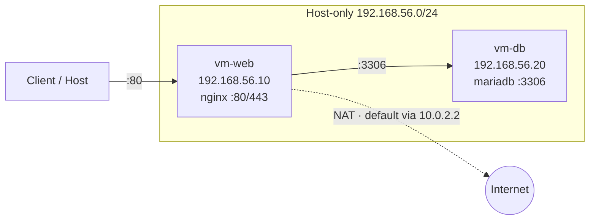
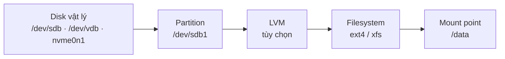
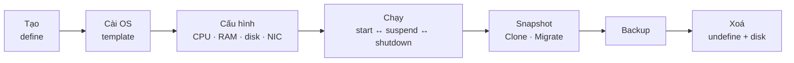
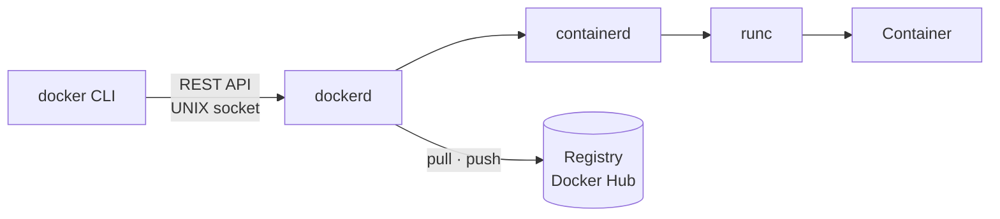
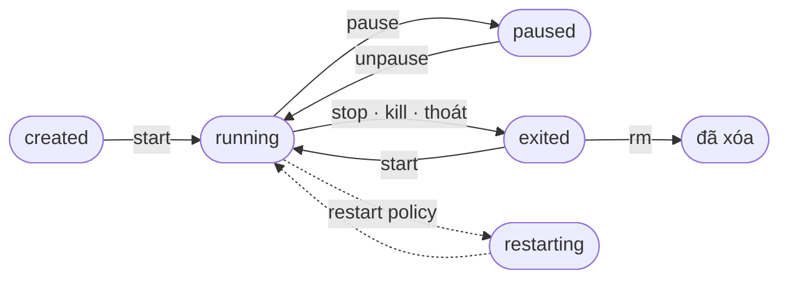
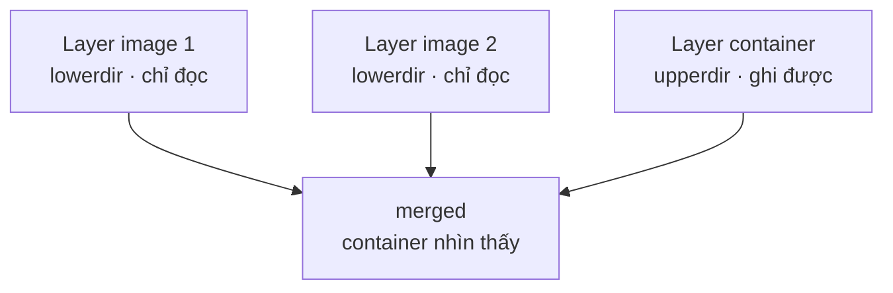

<div class="flex flex-col h-full justify-center">

<div class="text-sm tracking-widest uppercase opacity-70 mb-3">Báo cáo tiến độ học tập</div>

# Linux, Virtualization<br/>→ Container

<div class="text-lg opacity-85 mt-2 mb-6">Tổng kết kiến thức Tuần 1 và Tuần 2</div>

<div>
<span class="pill"><logos-linux-tux /> Linux</span>
<span class="pill"><carbon-network-3 /> Network</span>
<span class="pill"><carbon-data-base /> Storage</span>
<span class="pill"><carbon-security /> Permission</span>
<span class="pill"><carbon-virtual-machine /> Hypervisor</span>
<span class="pill"><logos-docker-icon /> Container</span>
</div>

<div class="mt-10 text-sm opacity-80">Người báo cáo: <b>Lê Tấn Lực</b> · <b>Đỗ Hoàng Hiếu</b></div>

</div>

---
layout: section
class: sec-w1
---

<div class="text-sm tracking-widest uppercase opacity-70 mb-2">Tuần 1</div>

# Linux, Virtualization<br/>và hạ tầng nền tảng

<div class="mt-6">
<span class="pill"><logos-linux-tux /> Tài nguyên máy chủ</span>
<span class="pill"><carbon-network-3 /> Network</span>
<span class="pill"><carbon-data-base /> Storage & LVM</span>
<span class="pill"><carbon-security /> User & Permission</span>
<span class="pill"><carbon-settings-services /> systemd & Firewall</span>
<span class="pill"><carbon-virtual-machine /> Hypervisor & VM</span>
</div>

---

# CPU và Load Average

<div class="grid grid-cols-2 gap-4">
<div class="flex flex-col gap-3">
<div class="card accent small">

### <carbon-chip /> Cấu trúc CPU

- **Socket → Core → Thread.** Mỗi thread là 1 **CPU logic** (`nproc`)
- **CPU time:** <span class="chip">us</span> ứng dụng · <span class="chip">sy</span> kernel · <span class="chip">wa</span> chờ disk · <span class="chip">st</span> bị VM khác lấy

</div>
<div class="card accent small">

### <carbon-meter /> Load average (1 · 5 · 15 phút)

- Số process đang chạy hoặc chờ CPU/I/O
- So với số CPU logic: **load = số CPU** là đầy tải, **gấp đôi** là quá tải

</div>
</div>
<div class="flex flex-col gap-3">

```bash
nproc ; uptime        # số CPU · load average
top                   # nhấn 1 để xem từng CPU
mpstat -P ALL 1 3     # thống kê từng core
```

| Chỉ số cao | Nguyên nhân → Xử lý |
|---|---|
| `us` | App tính toán nặng → tối ưu, thêm vCPU |
| `sy` | Nhiều system call → kiểm tra thread |
| `wa` | Chờ disk → điều tra disk, không phải thiếu CPU |
| `st` | Host quá tải → migrate VM |

</div>
</div>

---

# Bộ nhớ (RAM, swap) và Disk

<div class="grid grid-cols-2 gap-4">
<div class="flex flex-col gap-2">

```bash
free -h
#        total   used   free  buff/cache  available
# Mem:   3.8Gi  1.1Gi  210Mi       2.5Gi      2.4Gi
vmstat 1    # si/so > 0 liên tục = đang swap → thiếu RAM
```

<div class="card accent small">

### <carbon-data-1 /> RAM

- Linux dùng RAM rảnh làm **page cache**, nên *free* thấp là bình thường. Chỉ số cần nhìn là **available**
- **RSS** = RAM vật lý đang dùng · **VSZ** = không gian ảo (thường lớn, không đáng lo)
- **Swap** chậm hơn RAM hàng nghìn lần. Với DB server nên đặt `vm.swappiness` = 1–10
- Hết RAM và swap → **OOM Killer** giết process (`dmesg -T | grep -i oom`)

</div>
</div>
<div class="flex flex-col gap-2">
<div class="card accent small">

### <carbon-vmdk-disk /> Disk: hai câu hỏi khác nhau

**Còn bao nhiêu chỗ?** (capacity) và **disk có đang nghẽn không?** (I/O)

</div>

```bash
df -hT ; df -i          # hết inode cũng "đầy disk"
du -sh /var/* | sort -h # thư mục chiếm chỗ
iostat -xz 1 3          # %util ~100%, await cao = nghẽn
sudo iotop -o           # process nào đang đọc/ghi
lsof +L1                # file đã xoá nhưng còn bị giữ
```

| Chỉ số iostat | Ý nghĩa |
|---|---|
| `r/s`, `w/s` | Số IOPS đọc/ghi mỗi giây |
| `r_await`, `w_await` | Độ trễ (ms). SSD nên dưới vài ms |
| `%util` | ~100% liên tục = disk bão hòa |

</div>
</div>

---

# Process, giới hạn tài nguyên và phương pháp USE

<div class="grid grid-cols-2 gap-4">
<div class="card accent small">

### <carbon-flow /> Process

- Trạng thái: `R` chạy · `S` ngủ · `D` chờ I/O · `T` dừng · `Z` zombie
- Signal: **SIGTERM 15** dừng lịch sự · **SIGKILL 9** buộc dừng · **SIGHUP 1** reload cấu hình
- `nice` từ −20 (ưu tiên cao) đến 19. Giảm nice cần quyền root
- **cgroups** giới hạn CPU/RAM/IO cho nhóm process. Đây là nền tảng của systemd và container

</div>
<div>

```bash
ps -eo pid,ppid,user,stat,%cpu,%mem,cmd --sort=-%cpu | head
kill -15 1234 ; pkill -HUP nginx
nice -n 10 tar czf backup.tgz /data
ionice -c3 -p 1234              # I/O ưu tiên "idle"
sudo systemctl set-property nginx.service \
     CPUQuota=50% MemoryMax=512M
```

</div>
</div>

<div class="grid grid-cols-2 gap-4 mt-2">
<div class="card soft small">

<b>USE Method:</b> với mỗi tài nguyên, kiểm tra **U**tilization (mức dùng), **S**aturation (hàng đợi) và **E**rrors (lỗi). Quy trình 60 giây: `uptime` → `dmesg -T | tail` → `vmstat` → `mpstat` → `pidstat` → `iostat` → `free` → `sar -n DEV`

</div>
<div class="tip">
<div class="tip-title">💡 Ví dụ trình bày: server như một nhà hàng</div>
<b>CPU</b> là đầu bếp, <b>load</b> là số món đang chờ nấu: 4 đầu bếp mà 8 món chờ là quá tải gấp đôi. <b>RAM</b> là mặt bàn bếp, <b>cache</b> là nguyên liệu bày sẵn, dọn đi được ngay. <b>%wa</b> cao là đầu bếp đứng chờ người lấy đồ trong kho (disk).
</div>
</div>

---

# Địa chỉ IP, CIDR và routing

<div class="grid grid-cols-2 gap-4">
<div class="flex flex-col gap-2">

| CIDR | Mask | Host dùng được | Ví dụ |
|---|---|---|---|
| /8 | 255.0.0.0 | 16.777.214 | 10.0.0.0/8 (private) |
| /16 | 255.255.0.0 | 65.534 | 172.16.0.0/12 |
| /24 | 255.255.255.0 | 254 | 192.168.56.0/24 |
| /28 | 255.255.255.240 | 14 | Subnet nhỏ cho DMZ |
| /32 | 255.255.255.255 | 1 | Route tới 1 IP |

<div class="card accent small">

- **Số host = 2^(32 − prefix) − 2** (trừ địa chỉ network và broadcast)
- `192.168.56.10/24` → network `.0`, broadcast `.255`, host từ `.1` đến `.254`
- **Private (RFC 1918)** không ra Internet được, phải đi qua NAT
- Cùng subnet thì gửi thẳng qua switch (ARP lấy MAC). Khác subnet thì phải qua gateway

</div>
</div>
<div class="flex flex-col gap-2">
<div class="card accent small">

### <carbon-direction-fork /> Gói tin đi đâu?

- Kernel chọn route **khớp dài nhất** (longest prefix match). Không khớp route nào thì đi theo **default route** `0.0.0.0/0`
- Có nhiều route cùng độ dài thì route có **metric** thấp hơn được ưu tiên
- **Lỗi hay gặp:** 2 interface cùng có default gateway → traffic ra sai cổng. Chỉ nên có 1 default route

</div>

```bash
ip -br addr                 # interface + IP gọn
ip route
# default via 10.0.2.2 dev enp0s3 metric 100
# 192.168.56.0/24 dev enp0s8 src 192.168.56.10
ip route get 8.8.8.8        # kernel chọn route nào
ip route add 10.10.0.0/16 via 192.168.56.1
sysctl -w net.ipv4.ip_forward=1   # Linux làm router
```

</div>
</div>

---

# Cấu hình IP vĩnh viễn và DNS

<div class="grid grid-cols-2 gap-4">
<div class="flex flex-col gap-2">

```bash
# RHEL/Rocky – NetworkManager
nmcli con mod enp0s8 ipv4.method manual \
  ipv4.addresses 192.168.56.10/24 ipv4.gateway 192.168.56.1 \
  ipv4.dns "8.8.8.8 1.1.1.1"
nmcli con up enp0s8
```

```yaml
# Ubuntu – Netplan: /etc/netplan/01-lab.yaml
network:
  version: 2
  ethernets:
    enp0s8:
      addresses: [192.168.56.10/24]
      nameservers: { addresses: [8.8.8.8] }
# netplan try  → tự rollback sau 120s nếu mất kết nối
```

<div class="card warn xs">Lệnh <code>ip addr add</code> chỉ có tác dụng tạm thời và mất khi reboot. Muốn cấu hình vĩnh viễn phải dùng nmcli hoặc Netplan.</div>

</div>
<div class="flex flex-col gap-2">
<div class="card accent small">

### <carbon-search-locate /> DNS phân giải tên

- Thứ tự phân giải ghi trong `/etc/nsswitch.conf` (`hosts: files dns`): đọc `/etc/hosts` trước, sau đó mới hỏi DNS server trong `/etc/resolv.conf`
- **Luồng truy vấn:** client → resolver (8.8.8.8) → root → TLD (`.com`) → authoritative. Kết quả được cache theo **TTL**
- **Bản ghi:** A · AAAA · CNAME · MX · NS · PTR · TXT
- Ubuntu dùng **systemd-resolved**: resolv.conf trỏ tới `127.0.0.53`, xem cấu hình thật bằng `resolvectl status`

</div>

```bash
dig google.com +short ; dig -x 8.8.8.8
dig @1.1.1.1 example.com MX
getent hosts vm-db       # đi qua nsswitch (cả /etc/hosts)
# /etc/hosts trong lab
192.168.56.10  vm-web
192.168.56.20  vm-db
```

</div>
</div>

---

# Mạng ảo cho VM và sơ đồ Lab

<div class="grid grid-cols-2 gap-4">
<div class="flex flex-col gap-2">

| Chế độ | Cách hoạt động | Internet | Host↔VM | VM↔VM |
|---|---|:-:|:-:|:-:|
| **NAT** | Hypervisor làm router NAT | ✅ | Port fwd | Tùy |
| **Bridged** | Như máy thật trong LAN | ✅ | ✅ | ✅ |
| **Host-only** | Mạng riêng host + VM | ❌ | ✅ | ✅ |
| **Internal** | Chỉ VM với VM | ❌ | ❌ | ✅ |

<div class="card soft xs">

**KVM/libvirt:** `virbr0` (NAT 192.168.122.0/24, DHCP dnsmasq), bridge `br0` cho bridged · **VMware:** VMnet8 NAT, VMnet1 Host-only, VMnet0 Bridged · **Proxmox:** Linux bridge `vmbr0`

</div>
</div>
<div class="flex flex-col">



<div class="card accent xs mt-1">

**Luồng:** Client → `vm-web:80` qua mạng host-only → `vm-db:3306`. Riêng `vm-web` ra Internet qua NAT (NIC `enp0s3`, 10.0.2.15).

</div>

<div class="tip mt-2">
<div class="tip-title">💡 Ví dụ trình bày: mạng như hệ thống bưu điện</div>
<b>IP</b> là địa chỉ nhà, <b>subnet /24</b> là cùng một con phố nên gửi thư thì đưa tận tay (switch/ARP). <b>Gateway</b> là bưu cục đầu phố, <b>routing table</b> là bảng chỉ đường chọn tuyến cụ thể nhất. <b>DNS</b> là danh bạ, tra tên "vm-db" ra 192.168.56.20 trước khi gửi.
</div>
</div>
</div>

---

# Chuỗi lưu trữ, partition và LVM



<div class="grid grid-cols-2 gap-4 mt-2">
<div>

| | MBR (msdos) | GPT |
|---|---|---|
| Disk tối đa | 2 TiB | ~9.4 ZB (gần như không giới hạn) |
| Số partition | 4 primary (hoặc 3 + extended) | 128 mặc định |
| Boot | BIOS legacy | UEFI |
| Độ bền | 1 bảng duy nhất | Có bản sao header ở cuối disk + CRC |

```bash
lsblk -f ; blkid ; findmnt       # xem thiết bị, UUID, mount
parted /dev/sdb --script mklabel gpt \
  mkpart primary 0% 100% set 1 lvm on
```

</div>
<div class="flex flex-col gap-2">

| Thành phần | Là gì | Lệnh |
|---|---|---|
| **PV** Physical Volume | Disk/partition được khởi tạo cho LVM | `pvcreate`, `pvs` |
| **VG** Volume Group | "Bể" dung lượng gộp từ nhiều PV, chia thành PE (4 MiB) | `vgcreate`, `vgextend` |
| **LV** Logical Volume | "Partition ảo" cắt từ VG, nơi tạo filesystem | `lvcreate`, `lvextend` |

<div class="card soft small">
<b>Vì sao dùng LVM:</b> có một lớp trừu tượng giữa disk và filesystem, nhờ đó gộp được nhiều disk, <b>mở rộng khi đang chạy</b> và tạo snapshot.
</div>
</div>
</div>

---

# Thực hành LVM, filesystem và /etc/fstab

<div class="grid grid-cols-2 gap-4">
<div class="flex flex-col gap-2">

```bash
pvcreate /dev/sdb1
vgcreate vg_data /dev/sdb1
lvcreate -n lv_app -L 5G vg_data      # hoặc -l 100%FREE
mkfs.xfs /dev/vg_data/lv_app
# Mở rộng khi thêm disk /dev/sdc – không downtime
pvcreate /dev/sdc && vgextend vg_data /dev/sdc
lvextend -r -L +3G /dev/vg_data/lv_app   # -r: resize FS
# Snapshot LV trước khi nâng cấp
lvcreate -s -n snap_app -L 1G /dev/vg_data/lv_app
```

```bash
echo 'UUID=<uuid> /data/app xfs defaults,nofail 0 0' >> /etc/fstab
mount -a && findmnt --verify     # LUÔN kiểm tra trước reboot
```

<div class="tip">
<div class="tip-title">💡 Ví dụ trình bày: storage như kho hàng</div>
<b>Disk</b> là mảnh đất, <b>partition</b> là chia lô, <b>LVM</b> gộp nhiều lô thành một khu (VG) rồi chia lại linh hoạt thành các kho (LV). <b>Filesystem</b> là cách xếp kệ, <b>mount</b> là gắn biển địa chỉ "/data/app". Sắp đầy thì thêm disk, chạy vgextend + lvextend -r, không downtime.
</div>

</div>
<div class="flex flex-col gap-2">

| Tiêu chí | ext4 | xfs |
|---|---|---|
| Mặc định trên | Ubuntu, Debian | RHEL, Rocky, Alma |
| Mở rộng online | `resize2fs` | `xfs_growfs` |
| Thu nhỏ | Được (phải umount) | **Không hỗ trợ** |
| Điểm mạnh | Ổn định, linh hoạt | File lớn, song song cao |

<div class="card accent small">

### <carbon-document /> 6 cột của fstab

thiết bị · mount point · loại FS · options (`defaults`, `noatime`, `nofail`, `ro`) · dump · fsck pass (0 tắt, 1 cho `/`, 2 cho FS khác)
- Dùng **UUID** vì tên `/dev/sdX` có thể đổi khi thêm disk
- Một dòng sai có thể khiến máy vào **emergency mode**. `nofail` tránh lỗi này với disk phụ

</div>
</div>
</div>

---

# User, group và quyền cơ bản rwx

<div class="grid grid-cols-2 gap-4">
<div class="flex flex-col gap-2">

| File | Nội dung |
|---|---|
| `/etc/passwd` | user:x:UID:GID:mô tả:home:shell |
| `/etc/shadow` | Mật khẩu đã hash, chính sách hết hạn (chỉ root đọc) |
| `/etc/group` | group:x:GID:danh sách thành viên |
| `/etc/sudoers.d/` | Quy tắc sudo, sửa bằng `visudo` |

```bash
useradd -m -s /bin/bash -c "Dev Luc" luc ; passwd luc
groupadd devteam
usermod -aG devteam luc     # thiếu -a sẽ XOÁ các group cũ!
useradd -r -s /usr/sbin/nologin -d /opt/myapp myapp
chage -M 90 luc ; usermod -L luc ; userdel -r olduser
```

<div class="card soft xs">UID 0 là root. UID dưới 1000 là system user dành cho dịch vụ (nginx, mysql), không có shell đăng nhập.</div>

</div>
<div class="flex flex-col gap-2">

| Quyền | Số | Với file | Với thư mục |
|:-:|:-:|---|---|
| **r** | 4 | Đọc nội dung | Liệt kê tên file (`ls`) |
| **w** | 2 | Sửa nội dung | Tạo / xoá / đổi tên file bên trong |
| **x** | 1 | Thực thi | Đi vào (`cd`), truy cập file bên trong |

<div class="card accent small">

### <carbon-rule /> 3 quy tắc hay bị nhầm

1. Kernel kiểm tra theo thứ tự **owner → group → others**, áp dụng nhóm đầu tiên khớp, **không cộng dồn**
2. Đọc `/a/b/file` cần quyền `x` trên `/a` và `/a/b`. Kiểm tra bằng `namei -l`
3. **Xoá file** phụ thuộc quyền `w` của **thư mục**, không phụ thuộc quyền của file

</div>

```bash
chmod 640 config.yml ; chmod -R g+rX /srv/share
chown -R myapp:devteam /opt/myapp
umask      # 0022 → file mới 644, thư mục mới 755
```

</div>
</div>

---

# Quyền đặc biệt, ACL và sudo

<div class="grid grid-cols-2 gap-4">
<div class="flex flex-col gap-2">

| Bit | Số | Ý nghĩa | Ví dụ |
|---|:-:|---|---|
| **SUID** | 4000 | File chạy với quyền của owner | `/usr/bin/passwd` |
| **SGID** | 2000 | File mới trong thư mục kế thừa group | Thư mục dự án chung |
| **Sticky** | 1000 | Chỉ owner mới xoá được file của mình | `/tmp` (drwxrwxrwt) |

```bash
chmod 2775 /srv/project                  # SGID thư mục nhóm
find / -perm -4000 -type f 2>/dev/null   # audit file SUID
setfacl -m u:deploy:rx /opt/myapp        # ACL cho 1 user
setfacl -d -m g:devteam:rwX /srv/project # default ACL
getfacl /opt/myapp
```

</div>
<div class="flex flex-col gap-2">

```bash
# visudo -f /etc/sudoers.d/devteam
%devteam ALL=(root) /usr/bin/systemctl restart myapp, \
                    /usr/bin/journalctl -u myapp
deploy   ALL=(myapp) NOPASSWD: /opt/myapp/bin/deploy.sh
sudo -l -U luc        # xem user được phép chạy gì
```

<div class="card accent small">

### <carbon-locked /> Nguyên tắc quyền tối thiểu

- Không đăng nhập trực tiếp bằng root. Tắt `PermitRootLogin` trong sshd_config
- Mỗi ứng dụng một system user riêng, không có shell, chỉ sở hữu thư mục của nó
- **SELinux** (RHEL): rwx đúng mà vẫn bị từ chối thì kiểm tra `ls -Z`, `ausearch -m avc`, `restorecon -Rv`

</div>
</div>
</div>

<div class="tip mt-2">
<div class="tip-title">💡 Ví dụ trình bày: phân quyền như thẻ ra vào toà nhà</div>
<b>User</b> là nhân viên, <b>group</b> là phòng ban, <b>rwx</b> là được xem, sửa, đi vào. Chỉ user <code>myapp</code> đọc được file mật khẩu DB (600), dev chỉ đọc log, deploy ghi code qua ACL. <b>sudo giới hạn</b> là thẻ chỉ mở đúng phòng cần thiết, không phải chìa khoá vạn năng.
</div>

---

# systemd và vòng đời dịch vụ

<div class="grid grid-cols-2 gap-4">
<div class="flex flex-col gap-2">
<div class="card accent small">

**systemd** là PID 1 trên hầu hết bản Linux hiện đại. Nó khởi động hệ thống, quản lý dịch vụ, log (journald), mount và timer. Đơn vị quản lý là **unit**: `.service` `.socket` `.timer` `.mount` `.target`

</div>

| Lệnh `systemctl …` | Tác dụng |
|---|---|
| `start` / `stop` / `restart` | Chạy / dừng / khởi động lại ngay |
| `reload` | Đọc lại cấu hình, không ngắt kết nối |
| `enable --now` | Tự chạy khi boot và chạy ngay |
| `disable` / `mask` | Không tự chạy / cấm hoàn toàn |
| `status` · `list-units --failed` | Trạng thái, PID, log gần nhất · dịch vụ lỗi |
| `daemon-reload` | **Bắt buộc** sau khi sửa unit file |

```bash
systemctl edit nginx       # tạo override thay vì sửa file gốc
systemd-analyze blame      # dịch vụ nào làm boot chậm
journalctl -u myapp -f ; journalctl -b -1   # log boot trước
```

</div>
<div>

```ini
# /etc/systemd/system/myapp.service
[Unit]
Description=My Application
After=network-online.target
Wants=network-online.target

[Service]
Type=simple
User=myapp
WorkingDirectory=/opt/myapp
EnvironmentFile=/etc/myapp/app.env
ExecStart=/opt/myapp/bin/server --port 8080
Restart=on-failure
RestartSec=5
MemoryMax=512M
CPUQuota=50%
NoNewPrivileges=true

[Install]
WantedBy=multi-user.target
```

</div>
</div>

---

# Firewall và kiểm tra port từ đầu đến cuối

<div class="grid grid-cols-2 gap-4">
<div>

```bash
# firewalld (RHEL/Rocky) – quản lý theo zone
firewall-cmd --get-active-zones ; firewall-cmd --list-all
firewall-cmd --permanent --add-service=http
firewall-cmd --permanent --add-port=8080/tcp
firewall-cmd --permanent --add-rich-rule='rule family=ipv4
  source address=192.168.56.10/32 port port=3306
  protocol=tcp accept'      # chỉ vm-web được vào DB
firewall-cmd --reload       # permanent có hiệu lực sau reload
```

</div>
<div>

```bash
# ufw (Ubuntu)
ufw default deny incoming ; ufw default allow outgoing
ufw allow OpenSSH           # LUÔN mở SSH trước khi enable!
ufw allow 80/tcp
ufw allow from 192.168.56.10 to any port 3306
ufw enable ; ufw status numbered ; ufw delete 3
# mức thấp: nft list ruleset ; iptables -L -n -v
```

</div>
</div>

<div class="grid grid-cols-2 gap-4 mt-2">
<div class="card accent small">

### <carbon-checkmark-outline /> Kiểm tra port end-to-end

`ss -tulpn` (dịch vụ có LISTEN không, trên 0.0.0.0 hay 127.0.0.1?) → `nc -zv 192.168.56.20 3306` từ máy khác → `curl -I http://192.168.56.10`
- Dịch vụ chỉ listen **127.0.0.1** thì máy khác không vào được dù firewall đã mở. Phải sửa `bind-address`
- RHEL dùng port lạ thì cần mở cả SELinux: `semanage port -a -t http_port_t -p tcp 8081`

</div>
<div class="tip">
<div class="tip-title">💡 Ví dụ trình bày: systemd là quản lý ca, firewall là bảo vệ cổng</div>
systemd cho dịch vụ vào ca khi boot (<b>enable</b>), tự gọi lại khi dịch vụ "ngã" (<b>Restart=on-failure</b>) và ghi sổ nhật ký (<b>journalctl</b>). Firewall mặc định đóng mọi cửa, chỉ mở 80/443 cho khách. Cửa 3306 của DB chỉ mở cho đúng vm-web, nhờ vậy bề mặt tấn công nhỏ nhất.
</div>
</div>

---

# Hypervisor là gì?

<div class="card soft small mb-2">

**Hypervisor (VMM)** chia tài nguyên vật lý thành nhiều máy ảo độc lập. CPU hiện đại hỗ trợ ảo hóa phần cứng (**Intel VT-x / AMD-V**, kiểm tra bằng `grep -cE "vmx|svm" /proc/cpuinfo`) để VM chạy gần tốc độ thật.

</div>

<div class="grid grid-cols-2 gap-4">

| | Type 1 (bare-metal) | Type 2 (hosted) |
|---|---|---|
| Chạy trên | Trực tiếp phần cứng | Một OS có sẵn |
| Ví dụ | ESXi, Proxmox VE (KVM), Hyper-V, Xen, Nutanix AHV | VirtualBox, VMware Workstation/Fusion |
| Dùng cho | Production, datacenter | Lab cá nhân, dev |

<div class="card accent small">

### <carbon-layers /> KVM · QEMU · libvirt

- **KVM**: module kernel biến Linux thành hypervisor
- **QEMU**: giả lập thiết bị cho VM
- **libvirt**: lớp quản lý (`virsh`, `virt-install`, `virt-manager`)
- Proxmox và OpenStack đều dựa trên KVM

</div>
</div>

<div class="grid grid-cols-3 gap-3 mt-3">
<div class="card accent xs">

### <carbon-flash /> Thiết bị paravirtual

`virtio-blk/scsi` cho disk, `virtio-net` cho NIC, hiệu năng tốt hơn thiết bị giả lập. VMware dùng VMware Tools, `vmxnet3`, `pvscsi`.

</div>
<div class="card accent xs">

### <carbon-chart-multitype /> Overcommit

Cấp tổng vCPU/RAM cho các VM vượt tài nguyên thật. **vCPU 3–4:1** thường chấp nhận được. **RAM overcommit rủi ro hơn** (balloon, host phải swap).

</div>
<div class="card accent xs">

### <carbon-vmdk-disk /> Định dạng disk

**qcow2** (KVM, thin + snapshot) · **raw** (nhanh nhất) · **vmdk** (VMware) · **vhdx** (Hyper-V). Thin provisioning tiết kiệm chỗ nhưng có thể làm đầy datastore.

</div>
</div>

---

# Vòng đời VM và thao tác trên các nền tảng



<div class="grid grid-cols-2 gap-4 mt-2">
<div>

```bash
virt-install --name vm-web --memory 2048 --vcpus 2 \
  --disk size=20,format=qcow2,bus=virtio \
  --cdrom /iso/Rocky-9.iso --os-variant rocky9 \
  --network network=default,model=virtio
virsh list --all ; virsh dominfo vm-web
virsh start | shutdown | suspend | resume vm-web
virsh setvcpus vm-web 4 --config ; virsh setmem vm-web 4G --config
virsh attach-disk vm-web data.qcow2 vdb --persistent
virt-clone --original vm-web --name vm-web2 --auto-clone
virsh undefine vm-web2 --remove-all-storage
```

</div>
<div>

| Thao tác | Proxmox (`qm`) | VMware ESXi | VirtualBox |
|---|---|---|---|
| Tạo | `qm create 101 --memory 2048 --cores 2` | Wizard / PowerCLI `New-VM` | `createvm` + `modifyvm` |
| Start / Stop | `qm start` / `shutdown 101` | Power On / Shut Down | `startvm --type headless` |
| Snapshot | `qm snapshot 101 pre-upd` | Take Snapshot | `snapshot vm take` |
| Backup | `vzdump 101 --mode snapshot` | Veeam, vSphere Data Protection | `export vm -o vm.ova` |

</div>
</div>

---

# Snapshot và Backup không phải là một

<div class="grid grid-cols-5 gap-4">
<div class="col-span-3 flex flex-col gap-2">

| | Snapshot | Backup |
|---|---|---|
| Bản chất | Điểm khôi phục, lưu phần chênh lệch (delta) so với disk gốc | Bản sao độc lập, đầy đủ của dữ liệu |
| Vị trí | Cùng storage với VM | Storage khác, tốt nhất ở site khác |
| Mất storage gốc | **Mất luôn** snapshot | **Vẫn khôi phục được** |
| Dùng khi | Trước khi update, rollback nhanh | Phòng thảm họa, lưu trữ lâu dài |
| Giữ lâu | Không nên (làm chậm I/O, phình disk) | Theo chính sách retention |

```bash
virsh snapshot-create-as vm-web pre-update "Truoc khi update kernel"
virsh snapshot-revert vm-web pre-update
virsh dumpxml vm-web > /backup/vm-web.xml      # backup cold
qemu-img convert -O qcow2 -c vm-web.qcow2 /backup/vm-web.qcow2
```

</div>
<div class="col-span-2 flex flex-col gap-2">
<div class="card accent small"><b>Quy tắc 3-2-1:</b> 3 bản dữ liệu, trên 2 loại phương tiện, 1 bản ở ngoài site.</div>
<div class="card accent small"><b>Application-consistent:</b> với DB, dùng qemu-guest-agent (<code>virsh domfsfreeze</code>) hoặc dump DB trước khi snapshot để tránh dữ liệu ghi dở.</div>
<div class="card accent small"><b>RPO / RTO:</b> mất tối đa bao nhiêu dữ liệu / khôi phục trong bao lâu. Backup chưa từng restore thử thì coi như chưa có backup.</div>
<div class="tip">
<div class="tip-title">💡 Ví dụ: hypervisor như toà chung cư</div>
Hypervisor là ban quản lý chia căn hộ (VM). <b>Snapshot</b> là chụp ảnh căn hộ trước khi sửa, nhưng ảnh vẫn nằm trong toà nhà. <b>Backup</b> là bản sao cất ở toà nhà khác, cháy toà nhà vẫn khôi phục được.
</div>
</div>
</div>

---

# Troubleshooting nhanh

| Triệu chứng | Kiểm tra | Hướng xử lý |
|---|---|---|
| Server chậm | `uptime`, `top`, `vmstat`, `iostat` | Xác định CPU / RAM / IO, xử lý process nguyên nhân |
| Boot vào emergency mode | `journalctl -xb`, `/etc/fstab` | Sửa dòng fstab sai, thêm `nofail` |
| Disk đầy | `df -h`, `df -i`, `du`, `lsof +L1` | Dọn log (logrotate), restart process giữ file, mở rộng LV |
| Service không chạy | `systemctl status`, `journalctl -u` | Sửa config hoặc quyền, `daemon-reload` |
| Không truy cập được port | `ss -tulpn`, `firewall-cmd --list-all`, `nc -zv` | Sửa bind address, mở firewall, SELinux port |
| Permission denied | `id`, `namei -l`, `getfacl`, `ls -Z` | Sửa owner / mode / ACL, `restorecon` |
| VM không có mạng | `ip a`, `ip r`, `virsh domiflist`, `virsh net-list` | Kiểm tra NIC model, bridge, DHCP, default route |

<div class="card soft small mt-3">
<b>Tài liệu tham khảo:</b> RHEL Documentation · Ubuntu Server Guide · Brendan Gregg – USE Method · <i>The Linux Command Line</i>, <i>How Linux Works</i> · libvirt.org, Proxmox VE Admin Guide. Chứng chỉ phù hợp: <b>RHCSA (EX200)</b>, <b>LFCS</b>.
</div>

---
layout: section
class: sec-w2
---

<div class="text-sm tracking-widest uppercase opacity-70 mb-2">Tuần 2</div>

# Container

<div class="mt-6">
<span class="pill"><logos-docker-icon /> Kiến trúc</span>
<span class="pill">Image & Registry</span>
<span class="pill">Dockerfile</span>
<span class="pill">Network</span>
<span class="pill">Storage</span>
<span class="pill">Compose</span>
</div>

---
class: t2s
---

# Container là gì? So sánh với VM

<div class="grid grid-cols-2 gap-4">
<div class="flex flex-col gap-3">
<div class="card accent2 small">

### <carbon-container-software /> Container là tiến trình được cô lập

- Docker đóng gói và chạy ứng dụng trong một môi trường cô lập "lỏng"
- Container dùng chung **kernel host**, VM chạy **kernel khách** riêng → mật độ workload cao hơn
- **Namespaces** cô lập những gì tiến trình *nhìn thấy*
- **cgroups** giới hạn tài nguyên được *dùng*. RHEL thêm **SELinux** để bảo mật
- **Union FS**: image gồm nhiều layer chỉ đọc xếp chồng

</div>

| | Virtual Machine | Container |
|---|---|---|
| Ảo hóa | Phần cứng (hypervisor) | Hệ điều hành (kernel) |
| Kernel | Mỗi VM một kernel | Dùng chung kernel host |
| Kích thước · khởi động | Vài GB · phút | Vài chục MB · giây |

</div>
<div class="flex flex-col gap-3">

| Namespace | Cô lập |
|---|---|
| `PID` | ID tiến trình (container có PID 1 riêng) |
| `Network` | Interface, IP, port, route |
| `Mount` | Các điểm mount |
| `UTS` | Hostname, tên miền NIS |
| `IPC` | Hàng đợi tin nhắn, shared memory |
| `User` | UID/GID (root trong container ≠ root host) |
| `Cgroup` | Cây cgroup nhìn thấy |
| `Time` | Đồng hồ boot / monotonic |

<div class="card soft2 xs">
Từ Linux 3.8, tạo <b>user namespace</b> không cần đặc quyền. Các loại khác thường cần <code>CAP_SYS_ADMIN</code>. Đây là nền tảng của chế độ <b>rootless</b>.
</div>

</div>
</div>

---
class: t2s
---

# OCI và kiến trúc Docker



<div class="grid grid-cols-2 gap-4">
<div class="card accent2 small">

### <carbon-document /> 3 đặc tả OCI

- **Image Spec:** manifest, index, các layer và config
- **Runtime Spec:** chạy một "filesystem bundle". Luồng: tải image → giải nén thành bundle → runtime chạy
- **Distribution Spec:** API phân phối image, chuẩn hóa từ Docker Registry HTTP API V2
- Image và Distribution bản 1.1.0 (15/02/2024). **Podman, Buildah, Skopeo** tương thích OCI

</div>
<div class="card accent2 small">

### <carbon-flow /> Thành phần Docker

- Mô hình **client-server**. CLI gọi daemon qua REST API
- **dockerd** quản lý image, container, network, volume
- **containerd** lo vòng đời container, mặc định gọi **runc**
- **Docker Desktop** (Mac/Win/Linux, kèm Compose…) khác **Docker Engine** (`docker-ce`). Lab RHEL 9 dùng Engine

</div>
</div>

<div class="tip">
<div class="tip-title">💡 Ví dụ trình bày: VM là nhà riêng, container là căn hộ</div>
<b>VM</b> là nhà riêng, có móng riêng (kernel riêng). <b>Container</b> là căn hộ chung một móng (kernel host) nhưng có cửa khóa riêng (<b>namespace</b>) và công tơ điện nước riêng (<b>cgroups</b>). Nhẹ hơn và dọn vào nhanh hơn.
</div>

---
class: t2s
---

# Image = layers + config + manifest

<div class="grid grid-cols-2 gap-4">
<div class="flex flex-col gap-3">
<div class="card accent2 small">

### <carbon-layers /> Cấu trúc image (OCI)

- Gói chuẩn chứa file, binary, thư viện và cấu hình. Hai nguyên tắc: **bất biến** và **ghép từ layer**
- **Manifest** trỏ tới layer bằng **digest** (định danh theo nội dung). **Config** chứa lệnh chạy, biến môi trường
- **Multi-arch:** image index (Docker gọi là *manifest list*) trỏ tới một manifest cho mỗi nền tảng
- Sau khi tải, image được kiểm tra bằng hash

</div>

| | Tag `:1.4.2`, `:latest` | Digest `@sha256:…` |
|---|---|---|
| Bản chất | Con trỏ, có thể bị gán lại | Bất biến theo nội dung |
| Dùng khi | Dev, thử nghiệm | **Production**, cần tái lập |

</div>
<div class="flex flex-col gap-3">

```bash
docker pull nginx                 # không tag → :latest
docker pull nginx@sha256:<digest> # ghim đúng một bản
docker image ls                   # kích thước ĐÃ giải nén
docker image history nginx        # từng layer và lệnh tạo ra nó
docker image inspect nginx -f '{{.RepoDigests}}'
docker buildx imagetools inspect nginx   # các nền tảng multi-arch
```

<div class="tip">
<div class="tip-title">💡 Ví dụ trình bày: image là khuôn, container là bánh</div>
Một khuôn đúc được nhiều bánh, và sửa một chiếc bánh không làm đổi khuôn. <b>Tag</b> là nhãn "khuôn mới nhất", có thể dán sang khuôn khác. <b>Digest</b> là số seri khắc trên khuôn, không đổi được.
</div>

</div>
</div>

---
class: t2s
---

# Vòng đời container và các lệnh



<div class="grid grid-cols-2 gap-4">
<div class="tbl-xs">

| Lệnh | Chức năng |
|---|---|
| `run` | `create` + `start` |
| `create` / `start` | Tạo container chưa chạy / chạy container đã tạo |
| `stop` | Dừng có ân hạn: SIGTERM, hết hạn mới SIGKILL |
| `kill` | Gửi SIGKILL ngay (mặc định) |
| `rm` | Xóa container (`-f` nếu đang chạy) |
| `exec` | Chạy lệnh trong container đang chạy |
| `logs` · `inspect` | Xem log · chi tiết dạng JSON |
| `ps -a` · `top` · `stats` | Danh sách (cả đã dừng) · tiến trình · tài nguyên |

</div>
<div class="flex flex-col gap-2">

```bash
docker run -d --name web -p 8080:80 \
  --memory 512m --cpus 1 --restart unless-stopped nginx:1.27
docker ps -a --filter status=exited
docker exec -it web sh
docker logs -f --tail 50 web
docker stop web ; docker start web ; docker rm -f web
```

<div class="card soft2 xs">
<b>Trạng thái:</b> created · running · paused · restarting · exited · dead.<br/>
<b>Resource limit:</b> vượt <code>--memory</code> thì container bị <b>OOM kill</b>. <code>--cpus 1</code> giới hạn tối đa 1 core. Không đặt limit thì một container có thể chiếm hết tài nguyên host.
</div>

</div>
</div>

---
class: t2s
---

# Registry và quản lý image

<div class="grid grid-cols-2 gap-4">
<div class="flex flex-col gap-3">
<div class="card accent2 small">

### <carbon-cloud-upload /> Registry

- Tên đầy đủ: `registry[:port]/namespace/repo:tag`. `docker pull fedora` thực chất là `docker.io/library/fedora:latest`
- Tag có `host:port` ở đầu thì Docker push tới registry đó
- `docker login` lưu credential ở `~/.docker/config.json` (Podman/skopeo: `$XDG_RUNTIME_DIR/containers/auth.json`)
- Registry riêng `registry:3` chỉ để test. Production cần **TLS** và kiểm soát truy cập

</div>

| Docker Hub | Giới hạn pull |
|---|---|
| Chưa đăng nhập | 100 lượt / 6 giờ cho mỗi IPv4 (hoặc subnet IPv6 /64) |
| Personal | 200 lượt / 6 giờ |
| Pro / Team / Business | Không giới hạn |

</div>
<div class="flex flex-col gap-3">

```bash
docker run -d -p 5000:5000 --name registry registry:3
docker tag webapp:1.4.2 localhost:5000/team/webapp:1.4.2
docker push localhost:5000/team/webapp:1.4.2
docker image prune -a   # xóa image không dùng
docker system df        # xem dung lượng đã dùng
docker system prune     # dọn container dừng, cache…
```

| Lệnh | Đối tượng | Giữ được gì |
|---|---|---|
| `save` / `load` | Image | Các layer, tag và metadata |
| `export` / `import` | Filesystem container | Một lớp phẳng, mất lịch sử và config |

<div class="card soft2 xs">
Bị chặn <b>abuse limit</b> thì nhận lỗi 429 ngắn gọn. Hết <b>pull limit</b> thì nhận thông báo dài kèm link tài liệu. skopeo đọc được file <code>docker save</code> (định dạng docker-archive).
</div>

</div>
</div>

---
class: t2s
---

# Các lệnh Dockerfile

<div class="grid grid-cols-5 gap-4">
<div class="col-span-3 tbl-xs">

| Lệnh | Tác dụng |
|---|---|
| `FROM` | Bắt đầu một stage, chọn base image. Nhiều FROM là multi-stage. Bỏ tag thì dùng `latest` |
| `RUN` | Chạy lệnh và tạo layer mới. Cache không tự hết hạn, dùng `--no-cache` để chạy lại |
| `COPY` / `ADD` | COPY sao chép từ context, stage hoặc image. ADD thêm tải URL/Git, tự giải nén tar, `--checksum` |
| `WORKDIR` | Thư mục làm việc, tự tạo nếu chưa có. Dùng đường dẫn tuyệt đối thay cho `RUN cd` |
| `ARG` / `ENV` | ARG chỉ có lúc build (`--build-arg`), ENV nằm luôn trong image |
| `EXPOSE` | **Chỉ là tài liệu.** Muốn publish phải dùng `-p` / `-P` |
| `USER` | User/UID mặc định cho RUN, CMD, ENTRYPOINT phía sau |
| `VOLUME` | Mount point cho dữ liệu gắn ngoài |
| `HEALTHCHECK` | starting → healthy / unhealthy (mặc định 30s, thử 3 lần) |
| `LABEL` · `ONBUILD` | Metadata key-value · trigger chạy khi image được dùng làm base |

</div>
<div class="col-span-2 flex flex-col gap-2">

```dockerfile
# syntax=docker/dockerfile:1
FROM python:3.12-slim
WORKDIR /app
COPY requirements.txt .
RUN pip install --no-cache-dir \
      -r requirements.txt
COPY . .
USER 10001
EXPOSE 8000
HEALTHCHECK CMD curl -f \
  http://localhost:8000/health || exit 1
CMD ["gunicorn", "-b", "0.0.0.0:8000", "app:app"]
```

<div class="card warn xs">
<b>Không dùng ARG/ENV cho bí mật:</b> giá trị hiện trong <code>docker history</code>, và unset ENV ở layer sau không xóa được.<br/>
<b>Exec form</b> <code>["a","b"]</code> phải dùng nháy kép và không thay biến <code>$HOME</code>. <b>Shell form</b> chạy qua <code>/bin/sh -c</code>.
</div>

</div>
</div>

---
class: t2s
---

# CMD và ENTRYPOINT

<div class="tbl-xs">

| | Không ENTRYPOINT | ENTRYPOINT shell: `entry p1` | ENTRYPOINT exec: `["entry","p1"]` |
|---|---|---|---|
| **Không CMD** | Lỗi, không cho phép | `/bin/sh -c entry p1` | `entry p1` |
| **CMD `["cmd","p1"]`** | `cmd p1` | `/bin/sh -c entry p1` | `entry p1 cmd p1` |
| **CMD `cmd p1`** | `/bin/sh -c cmd p1` | `/bin/sh -c entry p1` | `entry p1 /bin/sh -c cmd p1` |

</div>

<div class="grid grid-cols-2 gap-4 mt-3">
<div class="card accent2 small">

### <carbon-rule /> Quy tắc dùng

- **ENTRYPOINT** là lệnh chính, **CMD** là tham số mặc định. `docker run image <args>` ghi đè CMD
- ENTRYPOINT dạng shell **bỏ qua CMD** và không nhận tín hiệu, nên tránh dùng
- Đặt ENTRYPOINT sẽ **reset CMD** kế thừa từ base image
- CMD gần như luôn dùng exec form. Script entrypoint kết thúc bằng `exec "$@"` để app thành **PID 1** và nhận SIGTERM

</div>
<div class="flex flex-col gap-2">

```bash
# Dockerfile
ENTRYPOINT ["/docker-entrypoint.sh"]
CMD ["nginx", "-g", "daemon off;"]
# docker-entrypoint.sh
set -e
envsubst < /tpl/app.conf > /etc/app.conf
exec "$@"            # thay shell bằng CMD → PID 1
# Khi chạy
docker run img                        # entrypoint + CMD mặc định
docker run img nginx -T               # ghi đè CMD
docker run -it --entrypoint sh img    # ghi đè ENTRYPOINT để debug
```

</div>
</div>

<div class="tip mt-2">
<div class="tip-title">💡 Ví dụ trình bày: ENTRYPOINT là nghề, CMD là món mặc định</div>
Container là một đầu bếp. <b>ENTRYPOINT</b> là nghề của đầu bếp (nấu phở), <b>CMD</b> là món mặc định (phở bò). Khách gọi món khác thì chỉ đổi CMD (phở gà), không đổi nghề.
</div>

---
class: t2s
---

# Build context, cache và multi-stage

<div class="grid grid-cols-2 gap-4">
<div class="flex flex-col gap-3">
<div class="card accent2 small">

### <carbon-folder /> Build context và .dockerignore

- Context là tập file build được truy cập: thư mục, URL Git, tarball hoặc `-`
- COPY file ngoài context hoặc bị ignore sẽ gây lỗi `failed to compute cache key: ... "/main.c": not found`
- `.dockerignore` đặt ở gốc context, cú pháp như `.gitignore`, giúp build nhanh hơn: `.git` `node_modules` `*.log` `.env`. Podman ưu tiên `.containerignore`

</div>
<div class="card accent2 small">

### <carbon-repeat /> Quy tắc cache

- Mỗi lệnh tạo 1 layer. **Một layer đổi thì mọi layer phía sau build lại**
- ADD/COPY so checksum nội dung file (không tính mtime). RUN chỉ so chuỗi lệnh
- Thứ tự đúng: OS packages → file dependency → cài dependency → mã nguồn
- `--pull` lấy base image mới, `--no-cache` bỏ cache

</div>
</div>
<div class="flex flex-col gap-2">

```dockerfile
FROM golang:1.23 AS build
WORKDIR /src
COPY go.mod go.sum ./
RUN go mod download        # được cache nếu go.mod không đổi
COPY . .
RUN CGO_ENABLED=0 go build -o /out/app .

FROM build AS test
RUN go test ./...

FROM gcr.io/distroless/static AS final
COPY --from=build /out/app /app
USER 65532
ENTRYPOINT ["/app"]
```

```bash
docker build --target test -t app:test .   # dừng ở stage test
docker build -t app:1.0 .                  # build tới stage cuối
```

<div class="card soft2 xs">
<b>Multi-stage:</b> mỗi FROM là một stage, chỉ chép artifact cần thiết sang stage cuối nên image nhỏ, không chứa compiler. Các stage chạy song song được và dùng lại được. Podman cũng hỗ trợ <code>--target</code>.
</div>

</div>
</div>

---
class: t2s
---

# BuildKit, buildx và best practices

<div class="grid grid-cols-2 gap-4">
<div class="flex flex-col gap-2">

```dockerfile
# syntax=docker/dockerfile:1
# Cache mount: giữ cache pip giữa các lần build
RUN --mount=type=cache,target=/root/.cache/pip \
    pip install -r requirements.txt
# Secret mount: không lưu vào layer, nằm ở /run/secrets/aws
RUN --mount=type=secret,id=aws \
    AWS_SHARED_CREDENTIALS_FILE=/run/secrets/aws \
    aws s3 cp s3://bucket/model.bin .
```

```bash
docker build --secret id=aws,src=$HOME/.aws/credentials .
docker buildx build --platform linux/amd64,linux/arm64 \
  -t registry.company.vn/team/app:1.0 --push .
```

<div class="card soft2 xs">
BuildKit là builder mặc định. <code>RUN --mount</code> có các kiểu bind (mặc định), cache, tmpfs, secret, ssh. Cache mount chỉ để tăng tốc và không xuất qua <code>--cache-to</code>, nên CI runner mới có cache rỗng. Multi-platform có 3 cách: QEMU, builder nhiều node native, cross-compile trong multi-stage.
</div>

</div>
<div class="flex flex-col gap-3">
<div class="card accent2 small">

### <carbon-checkmark-outline /> Best practices

1. Base image nhỏ và tin cậy (Official Images, Verified Publisher)
2. Ghim version/digest để tái lập được. Đổi lại, image không tự nhận bản vá
3. Rebuild thường xuyên vì image bất biến
4. Mỗi container một mối quan tâm. Không cài gói thừa vì container là tạm thời
5. Chạy **non-root** với UID/GID cố định. Tránh sudo (dùng gosu nếu cần)
6. Dùng `set -o pipefail`, vì `/bin/sh -c` chỉ xét mã thoát của lệnh cuối

</div>
</div>
</div>

---
class: t2s
---

# Network drivers: default bridge và user-defined bridge

<div class="grid grid-cols-2 gap-4">
<div class="flex flex-col gap-2">
<div class="tbl-xs">

| Driver | Đặc điểm |
|---|---|
| `bridge` | **Mặc định.** Mạng riêng trên host, ra ngoài qua NAT |
| `host` | Bỏ cô lập, dùng thẳng stack mạng của host |
| `none` | Cô lập hoàn toàn, không có mạng |
| `overlay` | Nối nhiều host (Swarm) |
| `macvlan` | Container có MAC riêng, trông như thiết bị vật lý |
| `ipvlan` | Giống macvlan nhưng không cấp MAC riêng |

</div>

```bash
docker network create -d bridge --subnet 172.20.0.0/24 my-net
docker network ls ; docker network inspect my-net
docker network connect my-net my-nginx     # gắn khi đang chạy
docker network disconnect my-net my-nginx
docker network rm my-net                   # phải disconnect trước
docker port my-nginx                       # xem các port đã publish
```

</div>
<div class="flex flex-col gap-2">
<div class="tbl-xs">

| | Default bridge (`docker0`) | User-defined bridge |
|---|---|---|
| Tạo | Tự động. Container không có `--network` sẽ gắn vào | `docker network create` |
| DNS theo tên | Không | **Có** |
| Cô lập | Mọi container chung một mạng | Tốt hơn, tách theo ứng dụng |
| Connect / disconnect | Phải tạo lại container | Được khi đang chạy |
| Trạng thái | Legacy | **Khuyến nghị** |

</div>

<div class="card soft2 xs">
Container ở 2 bridge khác nhau chỉ nói chuyện được qua port đã publish. Khoảng 1000 container trên một bridge có thể không ổn định. Một container gắn được nhiều network, chọn gateway bằng <code>gw-priority</code>. Docker <b>không</b> tạo rule firewall cho ipvlan, macvlan, host.
</div>

<div class="tip">
<div class="tip-title">💡 Ví dụ trình bày: user-defined bridge là mạng văn phòng</div>
Mỗi ứng dụng một văn phòng riêng, có tổng đài gọi nhau theo <b>tên</b> (DNS). <b>Default bridge</b> là sảnh chung, ai cũng ngồi chung và phải nhớ số máy lẻ (IP).
</div>

</div>
</div>

---
class: t2s
---

# Publish port, bảo mật và firewalld

<div class="grid grid-cols-2 gap-4">
<div class="flex flex-col gap-3">
<div class="card accent2 small">

### <carbon-network-3 /> Publish port

- `-p 8080:80` · `-p 192.168.1.100:8080:80` · `-p 8080:80/udp`. `-P` publish mọi port EXPOSE ra port ngẫu nhiên
- Mặc định bind **mọi địa chỉ** host (IPv4 + IPv6), tức là "không an toàn mặc định". Chỉ cho host truy cập: `-p 127.0.0.1:8080:80`
- **Docker 28:** host cùng L2 không còn truy cập được port publish vào localhost (trước 28.0.0 thì được)
- Đổi bind mặc định: `-o com.docker.network.bridge.host_binding_ipv4=127.0.0.1` hoặc `default-network-opts` trong `daemon.json`

</div>
<div class="card accent2 small">

### <carbon-search /> DNS nhúng, container gọi container

- Trên user-defined network, container gọi nhau bằng **tên** hoặc IP qua DNS nhúng `127.0.0.11`
- Trong cùng user-defined bridge, **mọi port mở cho nhau**, không cần `-p`

</div>
</div>
<div class="flex flex-col gap-3">
<div class="card warn small">

### <carbon-warning-alt /> Docker và firewall

- Docker xử lý trong bảng **nat** trước chain **INPUT**, nên port publish **vượt qua ufw**. Với firewalld hiệu ứng tương tự (kiểm chứng trong lab)
- firewalld: Docker tạo zone `docker` (target ACCEPT) và policy `docker-forwarding`
- Backend mặc định là iptables. nftables (`firewall-backend`) còn experimental và không tự bật IP forwarding. Không đặt `"iptables": false`

</div>

```bash
docker run -d --name web -p 127.0.0.1:8080:80 nginx
firewall-cmd --get-active-zones     # có zone docker
nft list ruleset | grep -i docker   # RHEL 9: iptables-nft
docker exec web cat /etc/resolv.conf   # nameserver 127.0.0.11
```

</div>
</div>

---
class: t2s
---

# Volume, bind mount và tmpfs

<div class="card soft2 small mb-3">
<b>Writable layer là tạm thời:</b> file tạo trong container nằm ở writable layer, phía trên các layer chỉ đọc của image. Layer này gắn riêng với từng container và <b>mất khi container bị xóa</b>.
</div>

<div class="grid grid-cols-2 gap-4">
<div class="flex flex-col gap-3">
<div class="tbl-xs">

| Loại | Đặc điểm | Dùng cho |
|---|---|---|
| **Volume** | Daemon quản lý, còn lại sau khi xóa container | Database, dữ liệu bền vững (**khuyến nghị**) |
| **Bind mount** | Nối thẳng đường dẫn host. Mặc định ghi được lên host | Mã nguồn khi dev, file cấu hình |
| **tmpfs** | Nằm trong RAM, mất khi container dừng | Dữ liệu tạm, nhạy cảm |

</div>
<div class="card accent2 small">

### <carbon-data-base /> Cú pháp --mount và -v

- Nên dùng `--mount`: rõ ràng và đủ tùy chọn (volume driver, `volume-subpath`, Swarm)
- `-v` tự tạo thư mục host nếu chưa có. `--mount` báo lỗi, trừ khi thêm `bind-create-src`
- **RHEL/SELinux:** nhãn chỉ đặt được bằng `-v ...:Z` hoặc `:z`
- Volume **rỗng** gắn vào thư mục có dữ liệu thì Docker copy dữ liệu vào (tắt bằng `volume-nocopy`). Bind mount thì **che** dữ liệu sẵn có

</div>
</div>
<div class="flex flex-col gap-2">

```bash
docker volume create pgdata
docker run -d --name db --mount \
  type=volume,src=pgdata,dst=/var/lib/postgresql/data postgres:16
docker run -d -v ./conf:/etc/nginx/conf.d:ro,Z nginx
docker run -d --tmpfs /tmp:size=64m app
docker volume ls ; docker volume inspect pgdata
#  "Mountpoint": "/var/lib/docker/volumes/pgdata/_data"
docker volume rm pgdata ; docker volume prune
```

<div class="card soft2 xs">
<b>Anonymous volume</b> có tên ngẫu nhiên, vẫn còn sau khi xóa container (trừ khi chạy với <code>--rm</code>) và không tự được dùng lại. Volume <b>không bao giờ tự bị xóa</b>.
</div>

<div class="tip">
<div class="tip-title">💡 Ví dụ trình bày: lưu dữ liệu như đồ dùng văn phòng</div>
<b>Writable layer</b> là bảng nháp, bị xóa khi tan ca. <b>Volume</b> là ổ cứng gắn ngoài, đổi máy vẫn còn. <b>Bind mount</b> là cửa thông thẳng sang kho của host. <b>tmpfs</b> là giấy note trên bàn.
</div>

</div>
</div>

---
class: t2s
---

# overlay2 và containerd image store

<div class="grid grid-cols-2 gap-4">
<div class="flex flex-col gap-2">



```bash
docker info | grep -E "Storage Driver|Backing Filesystem"
docker info -f '{{ .DriverStatus }}'
#   io.containerd.snapshotter.v1 nếu dùng containerd store
docker system df -v   # Images · Containers · Volumes · Cache
```

</div>
<div class="flex flex-col gap-3">
<div class="card accent2 small">

### <carbon-layers /> overlay2

- OverlayFS ghép **lowerdir** (layer image, chỉ đọc) và **upperdir** (layer container, ghi được) thành **merged**. Tối đa 128 lower layer
- Sửa file của lowerdir thì file được copy lên upperdir (copy-on-write). Xóa file thì tạo **whiteout**, file gốc vẫn nằm ở lowerdir
- **RHEL:** xfs phải có `ftype=1`. Không sửa tay `/var/lib/docker`

</div>
<div class="card accent2 small">

### <carbon-cube /> containerd image store

- Từ **Docker Engine 29**, đây là mặc định cho bản **cài mới**. Bản nâng cấp vẫn chạy overlay2
- Bật thủ công trong `/etc/docker/daemon.json`: `"features": {"containerd-snapshotter": true}`
- Tốn đĩa hơn (giữ cả layer nén lẫn đã giải nén), lưu ở thư mục riêng (thường `/var/lib/containerd`), không dùng được với `userns-remap`

</div>
</div>
</div>

---
class: t2s
---

# Docker Compose: v2 và file compose.yaml

<div class="grid grid-cols-2 gap-4">
<div class="flex flex-col gap-2">
<div class="tbl-xs">

| | Compose v1 | Compose v2 / v5 |
|---|---|---|
| Lệnh | `docker-compose` | `docker compose` (plugin) |
| Viết bằng | Python | Go (v5 có thêm Go SDK) |
| `version:` | 2.0 – 3.8 | Bỏ qua, đã lỗi thời |
| Hỗ trợ | Hết sau 6/2023 | Đang hỗ trợ |

</div>
<div class="card accent2 small">

### <carbon-flow /> Các phần tử chính

- **services · networks · volumes · configs · secrets**. Configs và secrets gắn vào container dưới dạng **file**
- `depends_on` có điều kiện `service_started`, `service_healthy`, `service_completed_successfully`. `restart: true` khởi động lại theo dependency
- `$$` để container tự đánh giá biến, Compose không nội suy
- `.env` nội suy biến **trong file Compose**, `env_file` đưa biến **vào container**
- Project name: `name:`, `-p` hoặc `COMPOSE_PROJECT_NAME`

</div>
<div class="card soft2 xs">
Tên file nên dùng <code>compose.yaml</code>. Cảnh báo "version is obsolete" thì xóa dòng <code>version:</code>. RHEL 9 cài gói <code>docker-compose-plugin</code>.
</div>
</div>
<div class="code-xs">

```yaml
name: shop
services:
  web:
    image: registry.company.vn/team/webapp:1.4.2
    ports: ["8080:3000"]
    environment: { DB_HOST: db }
    depends_on:
      db: { condition: service_healthy, restart: true }
    deploy:
      resources: { limits: { cpus: "0.5", memory: 512M } }
  db:
    image: postgres:16
    environment:
      POSTGRES_PASSWORD_FILE: /run/secrets/db_pass
    secrets: [db_pass]
    volumes: ["pgdata:/var/lib/postgresql/data"]
    healthcheck:
      test: ["CMD-SHELL", "pg_isready -U $${POSTGRES_USER:-postgres}"]
      interval: 10s
      retries: 5
volumes:
  pgdata: {}
secrets:
  db_pass: { file: ./db_pass.txt }
```

</div>
</div>

---
class: t2s
---

# Lệnh Compose, mạng mặc định và Podman Quadlet

<div class="grid grid-cols-2 gap-4">
<div class="flex flex-col gap-2">

```bash
docker compose up -d           # tạo network, volume, chạy nền
docker compose ps ; docker compose logs -f web
docker compose exec web sh     # vào shell của service web
docker compose config          # file đã hợp nhất + nội suy biến
docker compose down            # xóa container + network
docker compose down -v         # xóa luôn named volume ⚠
docker compose watch           # đồng bộ code khi dev
```

<div class="card accent2 small">

### <carbon-network-3 /> Mạng mặc định

- Compose tạo mạng `<project>_default` (bridge). Mỗi service có tên trong DNS nội bộ
- Gọi nhau bằng **tên service** và **port trong container** (`db:5432`), không dùng port host
- IP đổi khi container được tạo lại, nên luôn dùng tên. `network_mode: host` làm mất DNS theo tên service

</div>

<div class="tip">
<div class="tip-title">💡 Compose là bản phối cho cả dàn nhạc</div>
Một file mô tả từng nhạc công (<b>service</b>), sân khấu (<b>network</b>) và nhạc cụ riêng (<b>volume</b>). <code>up</code> là ra hiệu bắt đầu, <code>down</code> là thu dọn.
</div>

</div>
<div class="flex flex-col gap-2">
<div class="card accent2 small">

### <logos-redhat-icon /> Podman trên RHEL 9

- `podman compose` chỉ là lớp vỏ gọi provider bên ngoài (ưu tiên docker-compose nếu có). Đổi qua `compose_providers` hoặc `PODMAN_COMPOSE_PROVIDER`
- **Quadlet** (Podman ≥ 4.6): chạy container bằng **systemd**, cách Red Hat hướng dẫn

</div>

<div class="code-xs">

```bash
# ~/.config/containers/systemd/web.container
#   [Container]
#   Image=registry.company.vn/team/webapp:1.4.2
#   PublishPort=8080:3000
#   Volume=webdata:/data:Z
#   [Install]
#   WantedBy=default.target
systemctl --user daemon-reload  # generator sinh ra web.service
systemctl --user start web      # container tên systemd-web
loginctl enable-linger $USER    # chạy cả khi user không đăng nhập
```

</div>

</div>
</div>

---
layout: end
class: cover-dark
---

<div class="flex flex-col h-full justify-center items-center text-center">

# Cảm ơn anh/chị đã lắng nghe

<div class="mt-6 text-sm opacity-70">Lê Tấn Lực · Đỗ Hoàng Hiếu</div>

</div>
