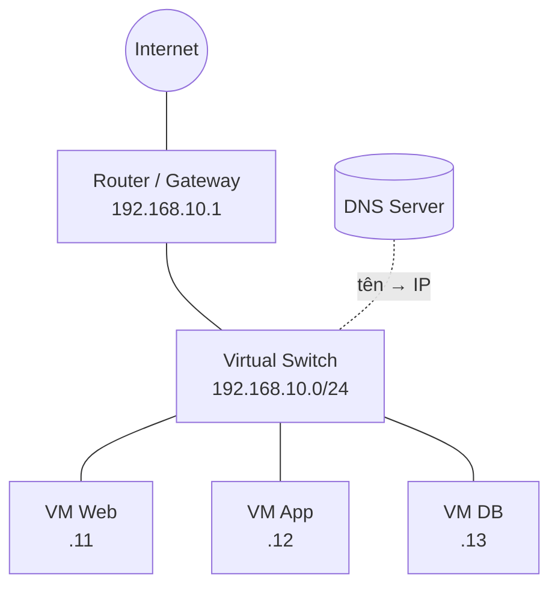
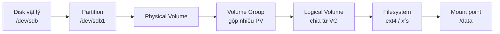
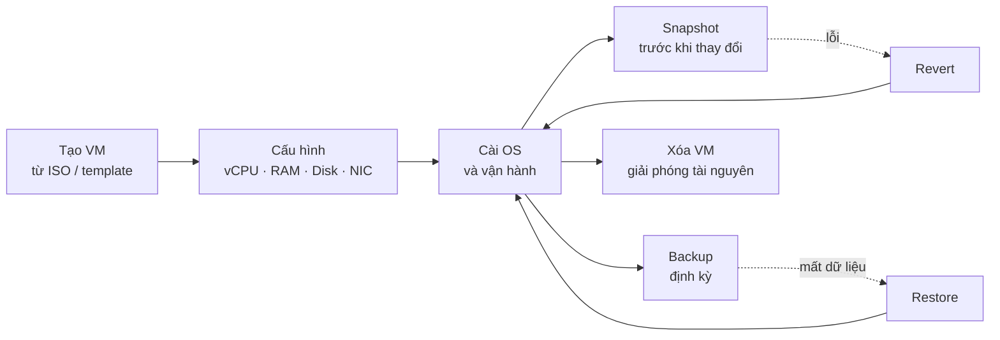
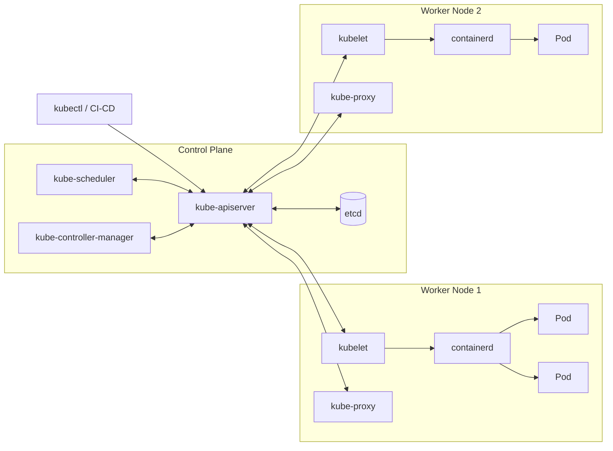

<div class="flex flex-col h-full justify-center">

<div class="text-sm tracking-widest uppercase opacity-70 mb-3">Báo cáo tiến độ học tập</div>

# Linux, Virtualization<br/>→ Container & Kubernetes

<div class="text-lg opacity-85 mt-2 mb-6">Tổng kết kiến thức Tuần 1 và Tuần 2</div>

<div>
<span class="pill"><logos-linux-tux /> Linux</span>
<span class="pill"><carbon-network-3 /> Network</span>
<span class="pill"><carbon-data-base /> Storage</span>
<span class="pill"><carbon-security /> Permission</span>
<span class="pill"><carbon-virtual-machine /> Hypervisor</span>
<span class="pill"><logos-docker-icon /> Container</span>
<span class="pill"><logos-kubernetes /> Kubernetes</span>
</div>

<div class="mt-10 text-sm opacity-70">Người báo cáo: ……………… · Ngày: ………………</div>

</div>

---

<div class="eyebrow"><carbon-dashboard /> Tổng quan</div>

# Tiến độ 2 tuần đầu

<div class="grid grid-cols-4 gap-3 mb-4">
  <div class="card stat"><div class="num">2</div><div class="lbl">tuần đã hoàn thành</div></div>
  <div class="card stat"><div class="num">8</div><div class="lbl">mảng kiến thức</div></div>
  <div class="card stat"><div class="num">6</div><div class="lbl">mảng hạ tầng nền tảng</div></div>
  <div class="card stat"><div class="num" style="color:var(--w2)">2</div><div class="lbl">mảng Container & K8s</div></div>
</div>

<div class="grid grid-cols-2 gap-4">
<div class="card accent">

### <carbon-calendar /> Tuần 1 – Linux, Virtualization và hạ tầng nền tảng

<div class="small">

1. Linux doanh nghiệp: quản lý CPU, RAM, disk, process
2. Network: IP, routing, DNS, kết nối giữa các VM
3. Storage: partition, LVM, filesystem, mount
4. User, group và permission
5. Service (systemd) và firewall
6. Hypervisor và vòng đời VM

</div>
</div>
<div class="card accent2">

### <carbon-calendar /> Tuần 2 – Container và Kubernetes Foundation

<div class="small">

7. Container: image, registry, volume, network, resource limit
8. Kiến trúc Kubernetes và vai trò từng thành phần

</div>

<div class="card soft2 mt-3 small">
<b>Mạch kiến thức:</b> hiểu máy chủ Linux → ảo hóa thành nhiều VM → đóng gói ứng dụng thành container → điều phối container ở quy mô cluster bằng Kubernetes.
</div>
</div>
</div>

---
layout: section
class: sec-w1
---

<div class="text-sm tracking-widest uppercase opacity-70 mb-2">Tuần 1</div>

# Linux, Virtualization<br/>và hạ tầng nền tảng

<div class="mt-6">
<span class="pill">Tài nguyên máy chủ</span>
<span class="pill">Network</span>
<span class="pill">Storage & LVM</span>
<span class="pill">User & Permission</span>
<span class="pill">systemd & Firewall</span>
<span class="pill">Hypervisor & VM</span>
</div>

---

<div class="eyebrow"><logos-linux-tux /> Tuần 1 · Chủ đề 1</div>

# Linux doanh nghiệp: quản lý tài nguyên máy chủ

<div class="grid grid-cols-2 gap-3">
<div class="card accent">

### <carbon-chip /> CPU

<div class="small">

- **Load average** (1/5/15 phút): số tiến trình đang chạy hoặc chờ CPU. So với số core (`nproc`): load > số core là quá tải
- `%us` user · `%sy` kernel · `%wa` chờ I/O · `%st` bị hypervisor lấy (steal)
- `%wa` cao → nghẽn disk, không phải thiếu CPU

</div>
</div>
<div class="card accent">

### <carbon-data-1 /> RAM

<div class="small">

- Nhìn cột **available**, không nhìn cột *free*: Linux dùng RAM trống làm **buff/cache** và trả lại khi cần
- **Swap** tăng liên tục → thiếu RAM thật, hệ thống chậm
- Hết RAM → **OOM killer** chọn và kill tiến trình (xem bằng `dmesg`)

</div>
</div>
<div class="card accent">

### <carbon-vmdk-disk /> Disk

<div class="small">

- `df -h` dung lượng theo filesystem · `du -sh` theo thư mục
- `df -i`: hết **inode** cũng không ghi được file dù còn dung lượng
- `iostat -x` / `iotop`: tìm tiến trình đọc ghi nhiều

</div>
</div>
<div class="card accent">

### <carbon-flow /> Process

<div class="small">

- Mỗi tiến trình có **PID**, **PPID**, trạng thái `R` chạy · `S` ngủ · `D` chờ I/O · `Z` zombie
- Ưu tiên: `nice` từ −20 (cao nhất) đến 19 · `renice` đổi khi đang chạy
- Dừng: `kill -15` (SIGTERM, dừng êm) trước, `kill -9` (SIGKILL) khi bị treo

</div>
</div>
</div>

---

<div class="eyebrow"><logos-linux-tux /> Tuần 1 · Chủ đề 1</div>

# Quy trình kiểm tra tài nguyên khi máy chủ chậm

<div class="grid grid-cols-5 gap-4">
<div class="col-span-3">

```bash
uptime                      # load average 1/5/15 phút
nproc                       # số core để so sánh với load
top -o %CPU                 # tiến trình ngốn CPU (htop: giao diện dễ đọc)
free -h                     # RAM: total / used / available / swap
vmstat 1 5                  # r (hàng đợi CPU), si/so (swap), wa (I/O)
df -h ; df -i               # dung lượng và inode
du -sh /var/* | sort -h     # thư mục chiếm nhiều dung lượng
ps aux --sort=-%mem | head  # top tiến trình dùng RAM
renice -n 10 -p <PID>       # hạ ưu tiên tiến trình nền
kill -15 <PID>              # dừng tiến trình
```

</div>
<div class="col-span-2 flex flex-col gap-3">

<div class="card soft small">

<b>Phân bổ tài nguyên cho ứng dụng</b>

- Giới hạn bằng **systemd**: `CPUQuota=50%`, `MemoryMax=1G` (dựa trên cgroups)
- Giới hạn theo user: `ulimit` / `/etc/security/limits.conf` (số file mở, số process)
- Với VM: điều chỉnh vCPU / RAM trên hypervisor

</div>

<div class="card warn small">
<b>Nguyên tắc:</b> đo trước rồi mới kết luận. Chậm có thể do CPU, RAM, disk I/O hoặc mạng.
</div>

</div>
</div>

<div class="outcome">🎯 <span><b>Đầu ra:</b> Kiểm tra và phân bổ được tài nguyên; giải thích được cho người khác</span></div>

---

<div class="eyebrow"><carbon-network-3 /> Tuần 1 · Chủ đề 2</div>

# Network: IP, subnet và routing

<div class="grid grid-cols-2 gap-4">
<div class="flex flex-col gap-3">
<div class="card accent small">

### <carbon-ip /> Địa chỉ IP và subnet

- IPv4 gồm 32 bit, viết dạng `192.168.10.15/24`
- **/24** → mask `255.255.255.0` → 256 địa chỉ, **254** dùng được (trừ địa chỉ mạng và broadcast)
- Dải private (RFC 1918): `10.0.0.0/8` · `172.16.0.0/12` · `192.168.0.0/16`
- **Gateway**: router để đi ra ngoài subnet

</div>
<div class="card accent small">

### <carbon-direction-fork /> Routing

- Cùng subnet → gửi thẳng (dùng ARP tìm MAC)
- Khác subnet → gửi tới gateway theo bảng định tuyến
- **Default route** `0.0.0.0/0`: đường đi khi không khớp route nào

</div>
</div>
<div>

```bash
ip -br a                       # IP từng interface
ip route                       # bảng định tuyến
ip route add 10.20.0.0/24 via 192.168.10.1
ss -tulpn                      # port đang lắng nghe
nmcli con mod eth0 ipv4.addresses 192.168.10.15/24 \
  ipv4.gateway 192.168.10.1 ipv4.method manual
```

| CIDR | Netmask | Số host dùng được |
|---|---|---|
| /30 | 255.255.255.252 | 2 |
| /24 | 255.255.255.0 | 254 |
| /16 | 255.255.0.0 | 65.534 |

</div>
</div>

---

<div class="eyebrow"><carbon-network-3 /> Tuần 1 · Chủ đề 2</div>

# DNS và kết nối mạng giữa các VM

<div class="grid grid-cols-2 gap-4">
<div class="flex flex-col gap-3">
<div class="card accent small">

### <carbon-search-locate /> DNS phân giải tên miền

1. Kiểm tra `/etc/hosts` (thứ tự cấu hình trong `/etc/nsswitch.conf`)
2. Hỏi DNS resolver trong `/etc/resolv.conf`
3. Resolver hỏi lần lượt: Root → TLD (`.com`, `.vn`) → Authoritative

Bản ghi chính: **A** (IPv4) · **AAAA** (IPv6) · **CNAME** (bí danh) · **MX** (mail) · **PTR** (IP → tên)

</div>

| Chế độ mạng VM | VM ↔ VM | VM ↔ Host | Ra Internet |
|---|:-:|:-:|:-:|
| NAT | Tùy | Hạn chế | ✅ |
| Bridged | ✅ | ✅ | ✅ |
| Host-only | ✅ | ✅ | ❌ |
| Internal | ✅ | ❌ | ❌ |

</div>
<div>



<div class="card soft small mt-2">

<b>Khi không kết nối được, kiểm tra từ dưới lên:</b> `ip a` có IP chưa → `ping` gateway → `ping` IP đích → `dig` tên miền → `nc -zv host port` kiểm tra port → firewall

</div>
</div>
</div>

<div class="outcome">🎯 <span><b>Đầu ra:</b> Vẽ và giải thích được luồng kết nối mạng giữa các VM trong Lab</span></div>

---

<div class="eyebrow"><carbon-data-base /> Tuần 1 · Chủ đề 3</div>

# Storage: partition, LVM và filesystem



<div class="grid grid-cols-3 gap-3 mt-3">
<div class="card accent small">

### Partition

- **MBR**: tối đa 4 primary, disk ≤ 2 TB
- **GPT**: tới 128 partition, disk lớn, dùng với UEFI
- Công cụ: `fdisk`, `gdisk`, `parted`

</div>
<div class="card accent small">

### LVM

- Gộp nhiều disk thành một **VG**
- **Mở rộng LV khi đang chạy**, không cần dừng dịch vụ
- Hỗ trợ snapshot LV
- Tách ứng dụng khỏi disk vật lý

</div>
<div class="card accent small">

### Filesystem

| | ext4 | xfs |
|---|---|---|
| Mở rộng | `resize2fs` | `xfs_growfs` |
| Thu nhỏ | Được | **Không** |
| Mặc định | Ubuntu | RHEL |

</div>
</div>

---

<div class="eyebrow"><carbon-data-base /> Tuần 1 · Chủ đề 3</div>

# Thực hành: thêm disk mới, tạo LVM và mount

<div class="grid grid-cols-2 gap-4">
<div>

```bash
lsblk                                 # 1. xem disk mới
parted /dev/sdb mklabel gpt           # 2. tạo bảng phân vùng
parted /dev/sdb mkpart primary 0% 100%
pvcreate /dev/sdb1                    # 3. tạo PV
vgcreate vg_data /dev/sdb1            # 4. tạo VG
lvcreate -L 20G -n lv_app vg_data     # 5. tạo LV 20 GB
mkfs.xfs /dev/vg_data/lv_app          # 6. tạo filesystem
mkdir -p /data && mount /dev/vg_data/lv_app /data
```

```bash
# Mở rộng thêm 10 GB, -r tự resize filesystem
lvextend -r -L +10G /dev/vg_data/lv_app
```

</div>
<div class="flex flex-col gap-3">
<div class="card accent small">

### <carbon-document /> Mount cố định qua `/etc/fstab`

```text
UUID=3f1c...  /data  xfs  defaults,nofail  0 0
```

- Dùng **UUID** (lấy bằng `blkid`) vì tên `/dev/sdX` có thể đổi sau khi khởi động lại
- `nofail`: disk lỗi thì máy vẫn boot được
- Luôn chạy `mount -a` để kiểm tra trước khi reboot

</div>
<div class="card warn small">
<b>Lỗi thường gặp:</b> sai một dòng trong fstab có thể khiến máy không boot, phải vào chế độ emergency để sửa.
</div>
</div>
</div>

<div class="outcome">🎯 <span><b>Đầu ra:</b> Tự thêm được disk mới, tạo LVM và mount vào hệ thống</span></div>

---

<div class="eyebrow"><carbon-security /> Tuần 1 · Chủ đề 4</div>

# User, group và permission

<div class="grid grid-cols-3 gap-3">
<div class="card accent small">

### <carbon-user /> User & group

- `/etc/passwd`: thông tin user
- `/etc/shadow`: mật khẩu đã hash
- `/etc/group`: nhóm và thành viên
- UID **0** = root · UID < 1000: tài khoản hệ thống
- Service account dùng shell `/sbin/nologin`

</div>
<div class="card accent small">

### <carbon-locked /> Quyền rwx

| | File | Thư mục |
|---|---|---|
| **r** (4) | Đọc nội dung | Liệt kê file |
| **w** (2) | Sửa nội dung | Tạo/xóa file |
| **x** (1) | Chạy file | Đi vào (`cd`) |

`750` = owner `rwx`, group `r-x`, others `---`

</div>
<div class="card accent small">

### <carbon-star /> Quyền đặc biệt

- **SUID** (4): chạy với quyền owner, ví dụ `passwd`
- **SGID** (2) trên thư mục: file mới kế thừa group
- **Sticky** (1): chỉ owner xóa được file, ví dụ `/tmp`
- **umask** `022` → file mới 644, thư mục 755
- **ACL** (`setfacl`) khi cần cấp quyền cho từng user cụ thể

</div>
</div>

<div class="grid grid-cols-2 gap-4 mt-1">
<div>

```bash
groupadd webapp
useradd -r -s /sbin/nologin -g webapp svc_web
chown -R svc_web:webapp /opt/webapp
chmod 750 /opt/webapp
chmod 640 /opt/webapp/config.env
setfacl -m u:deploy:rx /opt/webapp   # ACL cho user deploy
```

</div>
<div class="card soft small">

<b>Nguyên tắc least privilege:</b> mỗi ứng dụng chạy bằng user riêng, chỉ có quyền đúng thư mục cần dùng. Cấp sudo qua `visudo`, giới hạn đúng lệnh cần thiết, không cấp `ALL` khi không cần.

</div>
</div>

<div class="outcome">🎯 <span><b>Đầu ra:</b> Tạo và phân quyền được theo đúng yêu cầu của ứng dụng</span></div>

---

<div class="eyebrow"><carbon-settings-services /> Tuần 1 · Chủ đề 5</div>

# Service với systemd

<div class="grid grid-cols-2 gap-4">
<div class="flex flex-col gap-3">
<div class="card accent small">

### <carbon-application /> Khái niệm

- **systemd** là tiến trình PID 1, khởi động và quản lý mọi dịch vụ
- Đơn vị quản lý là **unit**: `.service`, `.socket`, `.timer` (thay cron), `.target` (nhóm unit)
- Unit file đặt trong `/etc/systemd/system/` (ưu tiên hơn `/usr/lib/systemd/system/`)
- **start** chạy ngay · **enable** tự chạy khi boot. Hai lệnh độc lập nhau

</div>

```bash
systemctl daemon-reload            # sau khi sửa unit file
systemctl enable --now webapp      # bật khi boot + chạy ngay
systemctl status webapp            # active / inactive / failed
systemctl reload webapp            # nạp lại config
journalctl -u webapp -p err --since "1 hour ago"
```

</div>
<div>

```ini
# /etc/systemd/system/webapp.service
[Unit]
Description=Web Application
After=network-online.target

[Service]
User=svc_web
WorkingDirectory=/opt/webapp
ExecStart=/opt/webapp/bin/server --port 8080
Restart=on-failure
RestartSec=5
MemoryMax=1G

[Install]
WantedBy=multi-user.target
```

<div class="card soft small mt-2">
<b>Restart=on-failure</b> giúp dịch vụ tự khởi động lại khi bị crash.
</div>

</div>
</div>

---

<div class="eyebrow"><carbon-firewall /> Tuần 1 · Chủ đề 5</div>

# Firewall: mở và đóng port theo yêu cầu

<div class="grid grid-cols-3 gap-3">
<div class="card accent small">

### Nguyên tắc

- **Mặc định chặn**, chỉ mở port cần dùng
- Giới hạn nguồn truy cập khi có thể (ví dụ DB chỉ nhận từ VM App)
- Các công cụ firewalld, ufw đều cấu hình **netfilter** (nftables/iptables) trong kernel

</div>
<div class="card accent small">

### firewalld (RHEL/Rocky)

- Quản lý theo **zone** (public, internal…)
- **runtime** mất khi reload · **--permanent** lưu cố định
- Mở theo **service** (`http`) hoặc theo **port** (`8080/tcp`)

</div>
<div class="card accent small">

### Kiểm tra sau khi mở port

1. Dịch vụ đang lắng nghe? `ss -tulpn`
2. Firewall đã mở? `firewall-cmd --list-all`
3. Từ máy khác: `nc -zv <ip> 8080`

</div>
</div>

<div class="grid grid-cols-2 gap-4 mt-2">
<div>

```bash
# firewalld
firewall-cmd --permanent --add-service=http
firewall-cmd --permanent --add-port=8080/tcp
firewall-cmd --permanent --remove-port=8080/tcp
# chỉ VM App (.12) được vào port DB 5432
firewall-cmd --permanent --zone=internal --add-source=192.168.10.12
firewall-cmd --permanent --zone=internal --add-port=5432/tcp
firewall-cmd --reload
```

</div>
<div>

```bash
# ufw (Ubuntu)
ufw default deny incoming
ufw allow 22/tcp
ufw allow from 192.168.10.12 to any port 5432 proto tcp
ufw delete allow 8080/tcp
ufw status numbered
```

</div>
</div>

<div class="outcome">🎯 <span><b>Đầu ra:</b> Quản lý được vòng đời dịch vụ; mở/đóng port theo yêu cầu</span></div>

---

<div class="eyebrow"><carbon-virtual-machine /> Tuần 1 · Chủ đề 6</div>

# Hypervisor và ảo hóa

<div class="grid grid-cols-2 gap-4">
<div class="card accent small">

### <carbon-bare-metal-server /> Type 1 – Bare-metal

Cài trực tiếp lên phần cứng, hiệu năng cao, dùng trong datacenter.

**Ví dụ:** VMware ESXi, Proxmox VE (KVM), Microsoft Hyper-V, XCP-ng

</div>
<div class="card accent small">

### <carbon-laptop /> Type 2 – Hosted

Chạy như phần mềm trên một hệ điều hành có sẵn, phù hợp lab và học tập.

**Ví dụ:** VirtualBox, VMware Workstation

</div>
</div>

<div class="grid grid-cols-3 gap-3 mt-3">
<div class="card small">

### vCPU & RAM

- Hypervisor chia CPU/RAM vật lý thành vCPU/vRAM cho từng VM
- **Overcommit**: tổng vCPU có thể lớn hơn số core thật, cần theo dõi để tránh tranh chấp

</div>
<div class="card small">

### Disk ảo

- **Thin**: cấp dần khi ghi, tiết kiệm dung lượng
- **Thick**: cấp đủ ngay, hiệu năng ổn định
- Định dạng: `qcow2` (KVM), `vmdk` (VMware), `vdi` (VirtualBox)

</div>
<div class="card small">

### Mạng ảo

- **Virtual switch / bridge** nối các VM với nhau và với mạng vật lý
- VM có card mạng ảo (vNIC), có thể gắn nhiều mạng khác nhau

</div>
</div>

---

<div class="eyebrow"><carbon-virtual-machine /> Tuần 1 · Chủ đề 6</div>

# Vòng đời VM: tạo, cấu hình, snapshot, backup



<div class="grid grid-cols-5 gap-4 mt-2">
<div class="col-span-3">

| | Snapshot | Backup | Clone / Template |
|---|---|---|---|
| Bản chất | Trạng thái tại một thời điểm, phụ thuộc disk gốc | Bản sao độc lập, lưu nơi khác | Bản sao để tạo VM mới |
| Dùng khi | Trước khi update, đổi cấu hình | Khôi phục khi hỏng disk, mất dữ liệu | Triển khai nhanh nhiều VM giống nhau |
| Lưu ý | Không giữ lâu, làm chậm disk | Phải thử restore định kỳ | Đổi hostname, IP sau khi clone |

</div>
<div class="col-span-2 flex flex-col gap-3">
<div class="card warn small">
<b>Snapshot không thay thế backup:</b> nếu disk gốc hỏng thì snapshot cũng mất theo.
</div>
<div class="card soft small">
<b>Quy tắc 3-2-1:</b> 3 bản dữ liệu, trên 2 loại phương tiện, 1 bản ở nơi khác.
</div>
</div>
</div>

<div class="outcome">🎯 <span><b>Đầu ra:</b> Thao tác được đầy đủ vòng đời VM trên hypervisor đang dùng</span></div>

---
layout: section
class: sec-w2
---

<div class="text-sm tracking-widest uppercase opacity-70 mb-2">Tuần 2</div>

# Container và<br/>Kubernetes Foundation

<div class="mt-6">
<span class="pill"><logos-docker-icon /> Image & Registry</span>
<span class="pill">Volume</span>
<span class="pill">Network</span>
<span class="pill">Resource limit</span>
<span class="pill"><logos-kubernetes /> Kiến trúc Kubernetes</span>
</div>

---

<div class="eyebrow t2"><logos-docker-icon /> Tuần 2 · Chủ đề 7</div>

# Container hoạt động như thế nào?

<div class="grid grid-cols-2 gap-4">
<div class="flex flex-col gap-3">
<div class="card accent2 small">

### <carbon-container-software /> Container là tiến trình được cô lập

Container không phải máy ảo. Đó là tiến trình chạy trên **kernel của host**, được kernel Linux cô lập bằng 3 cơ chế:

- **Namespaces**: cô lập những gì tiến trình *nhìn thấy*: `pid`, `net`, `mnt`, `uts` (hostname), `ipc`, `user`
- **cgroups**: giới hạn tài nguyên tiến trình *được dùng*: CPU, RAM, I/O
- **Union filesystem** (overlay2): ghép các layer chỉ đọc của image với một layer ghi riêng cho container

</div>
</div>
<div>

| Tiêu chí | Virtual Machine | Container |
|---|---|---|
| Ảo hóa | Phần cứng (hypervisor) | Hệ điều hành (kernel) |
| Hệ điều hành | Mỗi VM một Guest OS | Dùng chung kernel host |
| Kích thước | Vài GB | Vài chục – vài trăm MB |
| Khởi động | Phút | Giây |
| Mức cô lập | Mạnh | Yếu hơn |
| Phù hợp | Nhiều OS, cô lập cao | Microservice, CI/CD |

<div class="card soft2 small mt-2">
<b>Tóm lại:</b> VM ảo hóa cả một máy tính. Container chỉ cô lập ứng dụng, nên nhẹ và nhanh hơn nhưng phải dùng chung kernel.
</div>

</div>
</div>

<div class="outcome">🎯 <span><b>Đầu ra:</b> Giải thích được cơ chế container và khác biệt so với VM trong 5 phút</span></div>

---

<div class="eyebrow t2"><logos-docker-icon /> Tuần 2 · Chủ đề 7</div>

# Image và Registry

<div class="grid grid-cols-2 gap-4">
<div class="flex flex-col gap-3">
<div class="card accent2 small">

### <carbon-layers /> Image

- Template **chỉ đọc**, gồm nhiều **layer**. Mỗi lệnh trong Dockerfile tạo một layer
- Layer được **cache và dùng chung** giữa các image → build và pull nhanh
- Container = image + một layer ghi. Xóa container thì layer ghi mất

</div>
<div class="card accent2 small">

### <carbon-cloud-upload /> Registry

- Nơi lưu và phân phối image: Docker Hub, Harbor, GitLab Registry, ECR…
- Tên đầy đủ: `registry.company.vn/team/webapp:1.4.2`
- **Không dùng tag `latest`** cho production vì không biết chính xác phiên bản đang chạy

</div>
</div>
<div>

```dockerfile
# Multi-stage build: image cuối nhỏ gọn
FROM node:20-alpine AS build
WORKDIR /app
COPY package*.json ./
RUN npm ci          # layer được cache
COPY . .
RUN npm run build

FROM node:20-alpine
WORKDIR /app
COPY --from=build /app/dist ./dist
COPY --from=build /app/node_modules ./node_modules
USER node           # không chạy bằng root
EXPOSE 3000
CMD ["node", "dist/server.js"]
```

```bash
docker build -t registry.company.vn/team/webapp:1.4.2 .
docker push registry.company.vn/team/webapp:1.4.2
```

</div>
</div>

---

<div class="eyebrow t2"><logos-docker-icon /> Tuần 2 · Chủ đề 7</div>

# Volume, network và resource limit

<div class="grid grid-cols-3 gap-3">
<div class="card accent2 small">

### <carbon-data-volume /> Volume

Dữ liệu trong container mất khi container bị xóa, nên dữ liệu cần giữ phải để ngoài:

- **Named volume**: Docker quản lý, dùng cho database
- **Bind mount**: gắn thư mục host, tiện khi dev
- **tmpfs**: nằm trên RAM, dữ liệu tạm

</div>
<div class="card accent2 small">

### <carbon-network-4 /> Network

- **bridge** (mặc định): mạng riêng trên host, ra ngoài qua NAT
- **user-defined bridge**: container gọi nhau **bằng tên** nhờ DNS nội bộ
- **host**: dùng chung mạng của host
- **none**: không có mạng
- `-p 8080:80`: publish port host 8080 → container 80

</div>
<div class="card accent2 small">

### <carbon-meter /> Resource limit

- `--memory 512m`: vượt giới hạn thì container bị **OOM kill**
- `--cpus 1.5`: tối đa 1,5 core
- `--pids-limit`: giới hạn số tiến trình
- Không đặt limit thì một container có thể chiếm hết tài nguyên của host

</div>
</div>

```bash
docker network create appnet
docker volume create pgdata
docker run -d --name db  --network appnet -v pgdata:/var/lib/postgresql/data \
  -e POSTGRES_PASSWORD_FILE=/run/secrets/db_pass --memory 1g --cpus 1 postgres:16
docker run -d --name web --network appnet -p 8080:3000 \
  -e DB_HOST=db --memory 512m --cpus 0.5 registry.company.vn/team/webapp:1.4.2
docker stats                     # theo dõi CPU/RAM thực tế của từng container
```

---

<div class="eyebrow t2"><logos-kubernetes /> Tuần 2 · Chủ đề 8</div>

# Kiến trúc Kubernetes



<div class="grid grid-cols-2 gap-3 mt-1">
<div class="card soft2 small">
<b>Control Plane</b> là "bộ não": nhận yêu cầu, lưu trạng thái mong muốn, quyết định Pod chạy ở đâu và liên tục sửa lệch.
</div>
<div class="card soft2 small">
<b>Worker Node</b> là nơi chạy workload: nhận lệnh từ apiserver, chạy container và cấu hình mạng cho Service.
</div>
</div>

---

<div class="eyebrow t2"><logos-kubernetes /> Tuần 2 · Chủ đề 8</div>

# Vai trò từng thành phần

<div class="grid grid-cols-2 gap-4">
<div>

| Control Plane | Vai trò |
|---|---|
| **kube-apiserver** | Cổng duy nhất vào cluster. Xác thực, phân quyền, ghi/đọc etcd. Mọi thành phần khác giao tiếp qua đây |
| **etcd** | CSDL key-value lưu toàn bộ trạng thái cluster. Mất etcd là mất cluster, nên phải backup |
| **kube-scheduler** | Chọn node cho Pod mới dựa trên tài nguyên còn trống, affinity, taint/toleration |
| **controller-manager** | Chạy các controller (Deployment, ReplicaSet, Node…), so sánh trạng thái thực với mong muốn rồi sửa |

</div>
<div>

| Worker Node | Vai trò |
|---|---|
| **kubelet** | Agent trên mỗi node. Nhận Pod được giao, gọi runtime chạy container, báo cáo trạng thái và health check |
| **container runtime** | Chạy container thật qua chuẩn CRI: containerd, CRI-O |
| **kube-proxy** | Cấu hình iptables/IPVS để traffic tới **Service** được chia đều về các Pod |
| **CNI plugin** | Cấp IP cho Pod, cho Pod ở các node khác nhau nói chuyện được: Calico, Flannel, Cilium |

</div>
</div>

<div class="card soft2 small mt-3">

<b>Đối tượng cơ bản:</b> **Pod** (đơn vị nhỏ nhất, 1+ container) · **Deployment** (quản lý số bản sao, rolling update) · **Service** (IP/DNS ổn định trước nhóm Pod) · **Namespace** (chia cluster theo team/môi trường) · **ConfigMap / Secret** (cấu hình và thông tin nhạy cảm)

</div>

---

<div class="eyebrow t2"><logos-kubernetes /> Tuần 2 · Chủ đề 8</div>

# Luồng xử lý khi triển khai một ứng dụng

<div class="grid grid-cols-5 gap-4">
<div class="col-span-3 flex flex-col gap-1.5 small">
  <div class="card flex items-center" style="padding:0.4rem 0.8rem"><span class="step t2">1</span><span><b>kubectl apply</b> gửi Deployment (replicas: 3) tới <b>kube-apiserver</b>; apiserver xác thực rồi lưu vào <b>etcd</b></span></div>
  <div class="card flex items-center" style="padding:0.4rem 0.8rem"><span class="step t2">2</span><span><b>Deployment controller</b> thấy Deployment mới → tạo ReplicaSet → ReplicaSet tạo <b>3 Pod</b> (chưa có node)</span></div>
  <div class="card flex items-center" style="padding:0.4rem 0.8rem"><span class="step t2">3</span><span><b>kube-scheduler</b> thấy Pod chưa có node → chọn node phù hợp và ghi lại qua apiserver</span></div>
  <div class="card flex items-center" style="padding:0.4rem 0.8rem"><span class="step t2">4</span><span><b>kubelet</b> trên node đó thấy Pod được giao → gọi <b>containerd</b> pull image và chạy container</span></div>
  <div class="card flex items-center" style="padding:0.4rem 0.8rem"><span class="step t2">5</span><span>kubelet báo trạng thái <b>Running</b> về apiserver; <b>kube-proxy</b> cập nhật routing nếu có Service trỏ tới Pod</span></div>
  <div class="card soft2 xs" style="padding:0.4rem 0.8rem"><b>Cơ chế cốt lõi:</b> khai báo trạng thái mong muốn, hệ thống tự điều chỉnh. Pod chết thì controller tạo Pod mới thay thế.</div>
</div>
<div class="col-span-2 flex flex-col gap-2">

```yaml
apiVersion: apps/v1
kind: Deployment
metadata: { name: webapp }
spec:
  replicas: 3
  selector:
    matchLabels: { app: webapp }
  template:
    metadata:
      labels: { app: webapp }
    spec:
      containers:
      - name: web
        image: team/webapp:1.4.2
        resources:
          limits: { cpu: 500m, memory: 512Mi }
```


</div>
</div>

<div class="outcome">🎯 <span><b>Đầu ra:</b> Vẽ lại được kiến trúc Kubernetes không nhìn tài liệu</span></div>

---

<div class="eyebrow"><carbon-task-complete /> Tổng kết</div>

# Kết quả đạt được sau 2 tuần

| # | Mảng kiến thức | Đầu ra theo lộ trình | Trạng thái |
|:-:|---|---|:-:|
| 1 | Linux: tài nguyên máy chủ | Kiểm tra và phân bổ được tài nguyên; giải thích được cho người khác | ✅ |
| 2 | Network: IP, routing, DNS | Vẽ và giải thích được luồng kết nối mạng giữa các VM trong Lab | ✅ |
| 3 | Storage: partition, LVM, mount | Tự thêm được disk mới, tạo LVM và mount vào hệ thống | ✅ |
| 4 | User, group, permission | Tạo và phân quyền được theo đúng yêu cầu của ứng dụng | ✅ |
| 5 | systemd và firewall | Quản lý được vòng đời dịch vụ; mở/đóng port theo yêu cầu | ✅ |
| 6 | Hypervisor và vòng đời VM | Thao tác được đầy đủ vòng đời VM trên hypervisor đang dùng | ✅ |
| 7 | Container | Giải thích được cơ chế container và khác biệt so với VM trong 5 phút | ✅ |
| 8 | Kiến trúc Kubernetes | Vẽ lại được kiến trúc Kubernetes không nhìn tài liệu | ✅ |

<div class="grid grid-cols-2 gap-4 mt-3">
<div class="card soft small">
<b>Điểm mạnh:</b> ……………………………………………
</div>
<div class="card warn small">
<b>Cần củng cố thêm:</b> ……………………………………………
</div>
</div>

---
layout: end
class: cover-dark
---

<div class="flex flex-col h-full justify-center items-center text-center">

# Cảm ơn anh/chị đã lắng nghe

<div class="text-lg opacity-85 mt-2">Kế hoạch tiếp theo: ………………………………</div>

<div class="mt-8"><span class="pill"><carbon-chat /> Hỏi & Đáp</span></div>

</div>
